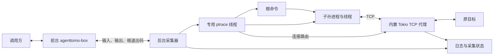

# agenttomo-box

提供两个公开子命令：`run` 执行命令并记录进程行为；`playground` 提供左侧 Docker 终端、右侧实时 trace 的网页。

`run` 通过 `/bin/sh -c` 启动命令，记录标准流、进程生命周期和文件打开路径，将支持的 TCP 连接劫持到同一采集进程内的代理，再转发到原目标。前台随根命令退出，后台采集器继续服务存活后代，直到它们全部退出并完成代理收尾。

使用 `clap`、Tokio、`nix` 和 Serde。当前文件/TCP 后端支持 Linux 5.3+ 的原生 x86_64 ABI；其他架构仍只有原来的进程生命周期跟踪，32 位兼容 syscall 不采集。需要环境允许对子进程 ptrace、读取其 `/proc` 信息、安装 seccomp 过滤器及绑定回环端口；不要求 root、`CAP_SYS_PTRACE`、eBPF、iptables 或 namespace。外层策略可能拒绝这些操作；跟踪或过滤器安装失败时不会执行用户命令。过滤器启用 `no_new_privs`，目标不能通过后续 exec 的 setuid/file capabilities 提权。

## run：执行与记录

在仓库根目录运行：

```bash
cargo run --quiet -p agenttomo-box -- run -c 'printf "hello\n"'
```

如果开发环境提供的 Cargo 缓存目录不可写，可先为当前 shell 指定用户级缓存：

```bash
export CARGO_HOME="$HOME/.cache/agenttomo-cargo"
```

输入通过管道或终端传入，也可以指定本次日志目录：

```bash
printf 'hello\n' | cargo run --quiet -p agenttomo-box -- run \
  --output-dir .agenttomo/demo \
  -c 'cat; printf "message on stderr\n" >&2'
```

`--output-dir` 指定的目录必须不存在，避免覆盖已有记录。省略时，每次运行自动创建 `.agenttomo/runs/<时间戳>-<PID>/`。相对路径基于当前工作目录，目标继承启动器的工作目录和环境变量。

## playground：Docker 终端与实时 trace

需要能访问本机 Docker daemon，且本地已有 `ubuntu:24.04` 镜像。启动时不会自动拉取镜像，也不会更改 Docker 或宿主权限配置。

```bash
cargo run --quiet -p agenttomo-box -- playground

# 允许从其他机器访问；打开启动日志中的 URL，并将地址换成服务器 IP。
cargo run --quiet -p agenttomo-box -- playground --listen 0.0.0.0:8080

# 指定本地兼容镜像和日志根目录。
target/debug/agenttomo-box playground --image ubuntu:24.04 --output-dir .agenttomo/playground
```

默认监听 `127.0.0.1:8080`，输出带随机令牌的访问 URL。页面和 WebSocket 都需要令牌；浏览器 WebSocket 还会校验 Origin。持有该 URL 的用户可以创建并操作容器；本版用于受信用户的诊断环境，没有多用户权限或配额管理。前端资源随二进制内置，运行时无需 Node.js 或 CDN。

每个页面创建一个临时容器，目标以服务用户的 UID/GID 运行，清空 capabilities，启用 `no-new-privileges`，保留 Docker 默认 seccomp。仅挂载只读 box 二进制和当前会话日志目录，不挂载宿主项目或 Docker socket。镜像需包含 `/bin/bash`，架构及动态链接库需兼容宿主构建的二进制；当前实测为 Linux x86_64 + Ubuntu 24.04。Docker daemon 必须能访问本机绑定路径，不支持远程 daemon。

网页终端使用真实 PTY，支持 Ctrl-C、窗口 resize 和 Bash 作业控制。PTY 会合并 stdout/stderr，合并输出记录在 `stdout.log`，`stderr.log` 为空。输入记录、进程事件和采集状态复用 `run` 的格式。

右侧展示可折叠的进程/任务树，点击节点查看行为时间线及后代，点击行为查看原始字段。fork/vfork/clone 建立创建关系；exec 保留同一任务，并显示程序从 a 切换成 b，退出后保留历史。文件路径、TCP 连接、上游状态及转发字节数展示在所属任务下。节点标注 TID，clone 分支不一概当作独立进程；运行内的 `task_id` 防止晚到的代理事件挂到复用 TID 的新任务。页面保留最近 1,000 条行为及所需祖先，过期行为显示省略数量，完整事件保存在日志中。

Shell 退出后禁用输入，后代仍继续采集，直到显示 `Collection complete`。关闭页面、点击 `New session` 或用 SIGINT/SIGTERM 停止服务，会删除对应的临时容器，日志保留在 `<output-dir>/<session-id>/run/`。外围 `session.json` 记录容器信息，`session-result.json` 记录结束原因及清理结果。主动关闭未完成会话时，内层采集状态可能保留为 `running`，不能视为已完整采集；查看外围结束原因区分中止与完成。SIGKILL 或主机故障无法执行清理，可通过容器标签 `io.agenttomo.playground=true` 定位遗留容器。

在当前 shell 尚未加载 docker 用户组的环境，可以临时使用：

```bash
sg docker -c 'target/debug/agenttomo-box playground --listen 0.0.0.0:8080'
```

## 记录内容

| 文件 | 内容 |
| --- | --- |
| `command.txt` | `-c` 接收到的原始命令 |
| `stdin.log` | 采集器收到并尝试转发给目标的输入字节 |
| `stdout.log` | 根命令和继承其 stdout 管道的后代输出 |
| `stderr.log` | 根命令和继承其 stderr 管道的后代输出 |
| `exit-code.txt` | 根命令退出时写入的退出码，带换行；根命令尚未完成或提前采集失败时为空 |
| `events.jsonl` | `process.fork/vfork/clone/exec/exit`、`file.open`、`network.connect/upstream/transfer` |
| `collection-status.json` | `running`、`complete` 或 `failed`，以及采集器 PID 和失败原因；以原子替换更新 |

`run` 的三个流分别按原始字节保存，支持非 UTF-8 数据，保留各自顺序，不记录三个流之间的交错时序。前台存活时，标准输出和标准错误同时转发给调用方；前台退出后，后代输出继续落盘，不再写调用方的终端。`run` 正常运行时不额外输出日志路径或状态行。

`stdin.log` 不证明目标实际消费了这些字节。目标提前关闭 stdin 时，日志可能包含已收到但未被目标消费的输入；根命令结束后停止转发，关闭输入管道写端，不继续等待调用方的 stdin。后代可以读完此前已入管道的字节，随后得到 EOF。

进程事件保留内核直接提供的 TID、创建者 TID、子 TID 和退出状态。`process.exec` 在成功 exec 停点定点读取 `/proc/<tid>/cmdline`，保存便于阅读的 `argv` 和保留原始 NUL 分隔字节的 `argv_bytes`；单次最多读取 1 MiB，截断或读取失败会明确标记。它不记录失败的 exec 尝试。当前 stdout/stderr 是管道汇总，尚不能归属到某一次 exec；重定向到其他文件或自行关闭这些管道的输出也不在其中。

文件采集覆盖 `open/openat/openat2/creat`，记录请求路径、原始路径字节、dirfd/相对路径基准、flags、返回 FD 或 errno，以及成功时可读取的实际 FD 路径。路径最多 4,096 字节，截断/不可读有明确标记；不读取文件内容，不虚拟化文件系统。记录在 syscall 退出停点生成；信号中断的内核重启码标为 `restart`，不能当作最终用户态 errno。没有返回停点的调用可能没有完成记录。尚未采集 read/write/mmap、rename/unlink、io_uring 或文件前后差异。

网络采集选择 `socket/connect`，按已观察 socket 的 inode 识别 fork/dup/exec 后的连接；只定点读取已知 FD 的链接，不遍历 FD 表。支持的 IPv4/IPv6 TCP 连接会进入独立的 Tokio 代理，双向转发并处理半关闭。UDP、Unix socket、继承自诊断作用域外的未知 socket、不同 netns 的连接保持直连，`network.connect` 记录跳过原因。未覆盖 sendto、TCP Fast Open、io_uring 和主动规避跟踪的路径，不能据此宣称所有网络都经过代理。

`network.connect` 的 `result_source=proxy_endpoint` 表示目标连接本地代理的结果；`network.upstream` 才是连接原目标的结果，失败可能体现为目标后续读写遇到 EOF/reset。`getpeername` 可见本地代理，目标 socket 的源端口/接口等选项不会复制到上游。`network.transfer` 记录连接 ID、原目标和上下行字节数；中断方向的未知计数使用 null。代理源标为 `tcp_proxy`，syscall/进程源标为 `ptrace`。HTTPS 仅透传 TLS 字节，不解密、不修改 HTTP、不保存报文内容。接受连接和连接上游各有 30 秒超时。

日志目录权限为 `0700`，文件为 `0600`（还受 umask 影响）。内容按原样记录，不做脱敏。

## 退出与范围

- 正常完成时透传 shell 的退出码；子命令由信号结束时返回 `128 + 信号编号`。
- 参数错误返回 `2`；初始化、启动或转发/记录失败返回 `125`，错误说明写到启动器 stderr。
- 参数和日志文件准备完成后才启动命令。已有日志目录会导致启动失败，不执行目标命令。
- `run` 的目标使用普通管道，不提供 PTY。需要交互终端时使用 `playground`。
- 根命令指最初启动的 `/bin/sh -c` 进程。它执行 `exec` 后 PID 不变，仍是同一个根进程；管道里的某个程序退出不等于整个根命令退出。
- 对前台的 SIGINT/SIGTERM 转发给根命令的进程组。后代自行 `setsid` 离开该组后仍被跟踪，但不再收到该组信号。支持目标的 SIGSTOP/SIGCONT。
- 当前不做逐进程输出归属、namespace/OverlayFS 隔离、任务总超时、模型明文采集或 Agent 语义 trace 关联。

## 前台与采集器生命周期



采集器与前台来自同一个二进制，内部启动模式不属于公开 CLI。辅助进程通过专用 Unix socket 等待跟踪器就绪，安装 seccomp 过滤器并确认成功，再 exec `/bin/sh -c`；握手不占用目标标准流。过滤器只对上述六类 syscall 触发 `RET_TRACE`，ptrace 获取其入口/出口，其他 syscall 不逐个停顿。ptrace 与 wait 始终由同一 OS 线程执行，代理在同一采集器进程的 Tokio runtime 内运行，不阻塞 tracer 等待远端网络。

两个完成时刻分别处理：

1. **根命令退出**：使用最终 `waitpid` 状态，不把 `PTRACE_EVENT_EXIT` 或主线程提前结束当作整个进程结束。排空输出管道在该边界已经排队的字节，刷新日志，发送退出码给前台；不等待后代关闭输出管道。
2. **采集完成**：跟踪正常 fork/vfork/clone 创建的后代，包含重新托管、双重 fork 和 `setsid` 后代。采集器作为 subreaper 回收孤儿；全部目标退出后继续转发代理已接收的上行数据，停止等待发往已退出目标的下行数据，排空代理事件和剩余输出，再写入 `complete`。不使用 PPID 扫描判断采集是否结束。

因此前台返回后，`exit-code.txt` 已可读取，但 `collection-status.json` 仍可能是 `running`。长期存活的后代会让采集器及其资源持续存在；后台采集失败会写入 `failed`，无法改变已经返回给调用方的退出码。

根命令完成前，前台意外退出或采集失败会终止本次跟踪：采集器通过父进程退出通知检测断连，tracer 配置 `PTRACE_O_EXITKILL`，防止留下无人采集的目标。正常根退出时先解除前台退出通知，因此前台正常结束不会杀死后代。采集器被 SIGKILL 时来不及更新状态，遗留的 `running` 不能视为已完成。

进程拆分不能越过外层生命周期：如果前台就是容器 PID 1、容器被停止或整个任务 cgroup 被清理，后台采集器也不能继续运行。它也不是安全沙箱，不阻断 `CLONE_UNTRACED` 等主动规避跟踪的方式。

## 模块边界

`cli/` 负责参数；`execution/` 管理前台、采集器、启动握手和 IPC；`tracing/` 负责进程跟踪和 syscall 分发；`syscall/` 提供过滤器、内存/寄存器机制；`collectors/file/` 与 `collectors/network/` 分别解释各自事件，互不引用；`proxy/` 独立处理异步 TCP 转发，不依赖 ptrace 或文件采集。`recording/` 负责日志，`terminal/` 封装 PTY，`playground/` 负责 Web/Docker。详见 [文件与 TCP 设计](../../docs/file-network-collection.md) 和 [Playground 设计](../../docs/playground-design.md)。

## 验证

集成测试使用本机 C 编译器 `cc` 构建小型进程测试程序，验证真实的 fork、setsid、线程退出和信号行为。

```bash
cargo test -p agenttomo-box
cargo clippy -p agenttomo-box --all-targets -- -D warnings

# 需本机 Docker 权限和已有 ubuntu:24.04 镜像，真实创建并清理容器。
cargo test -p agenttomo-box --test playground -- --ignored
```

默认测试包含 run 生命周期、PTY、访问控制、文件成功/失败/原始字节/信号重启、TCP 并发/只读地址/非阻塞/fork/dup/半关闭、上游失败、UDP 直连、退出时上传排空及过滤器安装失败。IPv6 集成用例在宿主未配置 `::1` 时明确输出未验证原因。Docker 测试验证终端到事件链路、页面断开清理、根退出后的后代采集、最后一条事件送达及服务停止清理。

树模型另用 Node.js 内置测试器验证（仅开发验证需要 Node.js，服务运行不需要）：

```bash
node --test crates/agenttomo-box/tests/process-tree.test.mjs
```

覆盖父子关系、连续 exec、TID 复用、非主线程 exec 的 TID 切换、乱序观察、晚到代理事件、无法归属的行为及历史保留边界。
