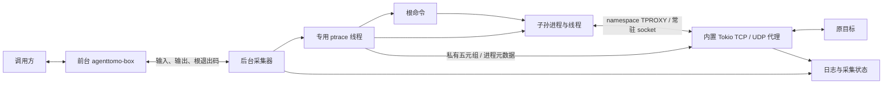

# agenttomo-box

提供两个公开子命令：`run` 执行命令并记录进程行为；`playground` 提供左侧 Docker 终端、右侧实时 trace 的网页。

`run` 通过 `/bin/sh -c` 启动命令，记录标准流、进程生命周期、文件打开路径和 mmap 调用，将支持的 TCP 连接和普通单播 UDP 报文劫持到同一采集进程内的独立代理，再转发到原目标。前台随根命令退出，后台采集器继续服务存活后代，直到它们全部退出并完成代理收尾。

使用 `clap`、Tokio、`nix` 和 Serde；HTTP Host / TLS SNI 解析复用 `httparse`、`rustls`。当前 syscall 后端支持 Linux 5.3+ 原生 x86_64。运行时需要 `ip`、`iptables`、`ip6tables`、允许创建 user/net namespace、namespace 内的 TPROXY/策略路由/NET_ADMIN/NET_RAW，以及对子进程 ptrace、seccomp 和 `/proc` 访问。不需要宿主 root、eBPF、TUN 或 FUSE。初始化失败时退出 125，不执行目标命令，不回退旧网络后端。目标保持调用者 UID/GID，启动前清空 capabilities 并启用 no_new_privs。

## run：执行与记录

在仓库根目录运行：

```bash
cargo run --quiet -p agenttomo-box -- run -c 'printf "hello\n"'
```

编译使用现有 shell 环境，不设置或覆盖 `CARGO_HOME`。

输入通过管道或终端传入，也可以指定本次日志目录：

```bash
printf 'hello\n' | cargo run --quiet -p agenttomo-box -- run \
  --output-dir .agenttomo/demo \
  -c 'cat; printf "message on stderr\n" >&2'
```

`--output-dir` 指定的目录必须不存在，避免覆盖已有记录。省略时，每次运行自动创建 `.agenttomo/runs/<时间戳>-<PID>/`。相对路径基于当前工作目录，目标继承启动器的工作目录和环境变量。

## playground：Docker 终端与实时 trace

需要能访问本机 Docker daemon，默认使用本地 `agenttomo-playground:24.04` 工具镜像。它基于 Ubuntu 24.04，预装 ifconfig/netstat、ip/ss、curl/wget、dig、nc、jq、strace、Python 等常用工具。首次使用前在仓库根目录构建（需要已有 Ubuntu 基础镜像和 apt 软件源访问）：

```bash
docker build --pull=false -t agenttomo-playground:24.04 docker/playground
```

完整工具列表与使用说明见[镜像说明](../../docker/playground/README.md)。Playground 启动时不会自动拉取或构建镜像，也不会更改 Docker 或宿主权限配置。

```bash
cargo run --quiet -p agenttomo-box -- playground

# 允许从其他机器访问；打开启动日志中的 URL，并将地址换成服务器 IP。
cargo run --quiet -p agenttomo-box -- playground --listen 0.0.0.0:8080

# 指定本地兼容镜像和日志根目录。
target/debug/agenttomo-box playground --image my-compatible-image:latest --output-dir .agenttomo/playground
```

默认监听 `127.0.0.1:8080`，输出带随机令牌的访问 URL。页面和 WebSocket 都需要令牌；浏览器 WebSocket 还会校验 Origin。持有该 URL 的用户可以创建并操作容器；本版用于受信用户的诊断环境，没有多用户权限或配额管理。前端资源随二进制内置，运行时无需 Node.js 或 CDN。

可选 Chrome 窗口与现有观察面板共用一个会话：

```bash
docker build --pull=false -t agenttomo-playground-chrome:24.04 docker/playground-chrome
target/debug/agenttomo-box playground --listen 0.0.0.0:18889 \
  --image agenttomo-playground-chrome:24.04 --browser --capture-http
```

`--browser` 增加 Terminal / Browser 切换，并自动从被跟踪进程树启动 Chrome。
`--capture-http` 同时启用现有 HTTPS 解密；Chrome 从 OverlayFS 中读取任务 CA，导入本会话容器的 NSS 信任库。
Chrome、其网络服务子进程的真实 PID、文件行为和 HTTP/HTTPS 内容都复用右侧观察窗口。
显示转发沿用同一个鉴权入口，不发布 VNC 端口。依赖、生命周期及协议边界见
[Chrome 镜像说明](../../docker/playground-chrome/README.md)。

每个页面创建一个临时容器，目标以服务用户的 UID/GID 运行，清空 capabilities，启用 `no-new-privileges`。为允许嵌套 user/net namespace，开发容器显式使用 `seccomp=unconfined`、`apparmor=unconfined`；这会放宽容器策略，不能作为恶意代码安全沙箱。仅挂载只读 box 二进制和当前会话日志目录，不挂载宿主项目或 Docker socket。镜像需包含 `/bin/bash`、`ip`、`iptables`、`ip6tables`，架构及动态链接库需兼容宿主构建的二进制；当前实测为 Linux x86_64 + Ubuntu 24.04。Docker daemon 必须能访问本机绑定路径，不支持远程 daemon。

网页终端使用真实 PTY，支持 Ctrl-C、窗口 resize 和 Bash 作业控制。PTY 会合并 stdout/stderr，合并输出记录在 `stdout.log`，`stderr.log` 为空。输入记录、进程事件和采集状态复用 `run` 的格式。

两侧采用统一深色主题。右侧在底部时自动跟随新增命令和事件；向上滚动查看历史会暂停跟随，回到底部后恢复。事件显示浏览器本地时区的日期和时间（毫秒精度，悬停查看 UTC）；任务标题的 `Elapsed` 列显示创建到退出的单调时间差，没有创建事件时从首次观察到的 exec 起算，连续 exec 不重置。运行中显示 `Running`，起止时间缺失时显示 `—`；这是包含等待和采集开销的经过时间。

右侧只展示进程节点与 PID，同一进程各线程的行为合并到一个时间线，不单独展示线程创建/退出。线程创建的子进程直接挂到所属进程；所有已知线程退出后才显示进程结束。节点默认收起，运行中新增可见事件短暂闪烁；展开状态和底部滚动跟随保留。exec 更新同一进程的命令，保留先前历史。TCP 网络记录关联建连发起进程；UDP 多参与者流仍显示未归属并保留参与者列表。点击行为查看原始字段，新记录统一使用 PID。PID 来自采集器 PID namespace 中的 TGID，未知时显示 `—`；进程生命周期标识 process_instance_id 防止把 PID 复用和晚到代理事件归到另一进程。

右侧顶部 Event filters 支持多选具体事件（如 `memory.mmap`、`file.open`）和类别通配符（如 `file.*`），默认全选，提供 Select all / Clear all 和半选状态。过滤行为行时保留进程树、真实状态与耗时，显示可见/保留事件数；新事件沿用当前页面的选择。页面保留最近 1,000 条原始行为及必要祖先，过滤前后的完整日志继续保存在磁盘。

Shell 退出后禁用输入，后代仍继续采集，直到显示 `Collection complete`。关闭页面、点击 `New session` 或用 SIGINT/SIGTERM 停止服务，会删除对应的临时容器，日志保留在 `<output-dir>/<session-id>/run/`。外围 `session.json` 记录容器信息，`session-result.json` 记录结束原因及清理结果。主动关闭未完成会话时，内层采集状态可能保留为 `running`，不能视为已完整采集；查看外围结束原因区分中止与完成。SIGKILL 或主机故障无法执行清理，可通过容器标签 `io.agenttomo.playground=true` 定位遗留容器。

宿主终端连续 Ctrl-C 不会打断 Docker 清理子进程。删除命令异常时会复核容器是否已不存在，避免 daemon 已完成删除但 CLI 被中断时误报失败；真正失败会显示退出码/信号、Docker 错误和复核结果。只清理当前服务自己的会话容器，不删除其他手动启动的容器。

在当前 shell 尚未加载 docker 用户组的环境，可以临时使用：

```bash
sg docker -c 'target/debug/agenttomo-box playground --listen 0.0.0.0:8080'
```

## 记录内容

### HTTP/HTTPS 内容采集

```bash
target/debug/agenttomo-box playground --listen 0.0.0.0:18889 --capture-http

target/debug/agenttomo-box run --capture-http \
  --http-body-max-bytes 65536 --http-body-total-bytes 67108864 \
  -c 'curl https://www.baidu.com'
```

打开服务输出的 token 链接后，右侧 **Traffic** 可查看真实请求/响应头、正文及 PID；原进程树、文件预览和事件 JSON 详情继续保留。正文默认每方向 64 KiB、每次运行共 64 MiB，单方向可配置到 1 MiB，设置 0 只保留头信息。达到保存上限不会截断转发。正文在该条消息结束或中止后显示，明确标注截断、未完整接收或保存失败。

`--capture-http` 同时启用 HTTP/1.1 解析和 TLS 解密，默认不启用。目标 helper 在私有 mount namespace 中用 OverlayFS 覆盖 `/etc/ssl/certs`，保留原证书并追加本次 CA，不修改 lower。要求 Debian/Ubuntu 的 `ca-certificates.crt`、允许创建 mount namespace 和挂载 tmpfs/OverlayFS；失败停止启动，不静默回退。上游 TLS 使用原证书库校验；不会因目标使用 `curl -k` 而跳过代理的上游校验。只保存公开 CA PEM，私钥只驻留采集器内存。

当前限 HTTP/1.1；TLS 协商到 HTTP/1.1，不支持 HTTP/2-only、QUIC、证书固定、mTLS、ECH、STARTTLS 或自带证书库的自动注入。CA 有效期 24 小时，暂不支持跨期轮换。普通 HTTP 压缩正文保留原压缩字节。完整边界见[内容检查设计](../../docs/content-inspection-design.md)。

SSE 和 WebSocket（包括 HTTPS SSE / WSS）在 Traffic 的 **Messages** 页实时展示：方向、开始时间、事件/消息类型、内容、复制和原始详情。滚到底部自动跟随，向上滚动或选旧消息会暂停；点击 **Follow latest** 恢复。SSE 支持多行事件及 gzip/deflate，WebSocket 支持掩码、分片、二进制、ping/pong/close 和 permessage-deflate。

默认每条保留 64 KiB，整个运行保留最近 4 MiB（内容加元数据）且最多 1,000 条，旧消息和索引一起淘汰，不截断应用转发。可通过 `--stream-message-max-bytes`、`--stream-window-bytes`、`--stream-window-messages` 调整，任一字节上限设为 0 会关闭流消息保留。消息保存到独立 SQLite 窗口，普通 HTTP 正文预算保持原含义。解析超限、未知扩展、存储/排队丢失和过期内容会明确显示。

| 文件 | 内容 |
| --- | --- |
| `command.txt` | `-c` 接收到的原始命令 |
| `stdin.log` | 采集器收到并尝试转发给目标的输入字节 |
| `stdout.log` | 根命令和继承其 stdout 管道的后代输出 |
| `stderr.log` | 根命令和继承其 stderr 管道的后代输出 |
| `exit-code.txt` | 根命令退出时写入的退出码，带换行；根命令尚未完成或提前采集失败时为空 |
| `events.jsonl` | `process.fork/vfork/clone/exec/exit`、`file.open`、`memory.mmap`、`network.upstream/protocol/transfer`、`network.udp.send/receive/transfer/error`；开启内容采集时还有 `network.http.*` 和 `network.tls.error` |
| `http-bodies.bin` | 开启内容采集时保存的请求/响应正文前缀，按事件中的 offset/captured_bytes 读取 |
| `task-ca.pem` | 本次解密任务的公开 CA，不含私钥 |
| `file-previews.bin` | 启用文件预览时保存有总大小上限的内容快照；事件通过 offset / captured_bytes 引用，不内嵌到 JSONL |
| `collection-status.json` | `running`、`complete` 或 `failed`，以及采集器 PID 和失败原因；以原子替换更新 |

每条 JSONL/WS 事件都有独立的 `category`，用于后续过滤；`kind` 继续表示具体行为，`source` 表示采集来源。字段为新增兼容字段，旧日志可以从 kind 前缀推导类别。

| category | 内容 | kind 示例 |
| --- | --- | --- |
| `network` | 出口连接、流量、域名与代理错误 | `network.upstream`、`network.udp.send` |
| `file` | 文件操作 | `file.open` |
| `process` | 命令执行、子进程创建及退出 | `process.exec`、`process.fork`、`process.exit` |
| `memory` | 内存映射 | `memory.mmap` |
| `other` | 暂未归入以上类别的扩展事件 | 保留原 kind |

`run` 的三个流分别按原始字节保存，支持非 UTF-8 数据，保留各自顺序，不记录三个流之间的交错时序。前台存活时，标准输出和标准错误同时转发给调用方；前台退出后，后代输出继续落盘，不再写调用方的终端。`run` 正常运行时不额外输出日志路径或状态行。

`stdin.log` 不证明目标实际消费了这些字节。目标提前关闭 stdin 时，日志可能包含已收到但未被目标消费的输入；根命令结束后停止转发，关闭输入管道写端，不继续等待调用方的 stdin。后代可以读完此前已入管道的字节，随后得到 EOF。

事件使用 schema_version=2：核心身份为 `pid` 与运行内 `process_instance_id`，创建事件另有 `parent_pid`、`child_pid` 和 `child_process_instance_id`。同一进程的各线程共享身份，仅在新进程创建和整个进程结束时记录生命周期；文件、mmap、TCP/UDP 代理沿用同一身份。新事件及网络参与者不再导出 tid/task_id。线程号仅用于底层 ptrace 停点配对和内存访问。旧 schema v1 日志由独立兼容读取器展示。`process.exec` 在成功 exec 停点定点读取 `/proc/<tid>/cmdline`，保存便于阅读的 `argv` 和保留原始 NUL 分隔字节的 `argv_bytes`；单次最多读取 1 MiB，截断或读取失败会明确标记。它不记录失败的 exec 尝试。当前 stdout/stderr 是管道汇总，尚不能归属到某一次 exec；重定向到其他文件或自行关闭这些管道的输出也不在其中。

文件采集覆盖 `open/openat/openat2/creat`，记录请求路径、原始路径字节、dirfd/相对路径基准、flags、返回 FD 或 errno，以及成功时可读取的实际 FD 路径。路径最多 4,096 字节，截断/不可读有明确标记；不虚拟化文件系统。元数据在 syscall 退出停点生成；信号中断的内核重启码标为 `restart`，不能当作最终用户态 errno。没有返回停点的调用可能没有完成记录。尚未采集文件 read/write、rename/unlink、io_uring 或文件前后差异。

成功打开可读普通文件时，采集器从已知 FD 固定原文件对象，记录器异步保存有上限的前缀快照，不移动应用的读取位置。默认每个文件最多 **64 KiB**、每次运行最多 **16 MiB**；`run` 和 `playground` 都支持 `--file-preview-max-bytes`（最大 1 MiB，0 禁用）与 `--file-preview-total-bytes`（0 禁用）。例如 `agenttomo-box playground --file-preview-max-bytes 131072 --file-preview-total-bytes 33554432`。只预览本地 ext/XFS/Btrfs/OverlayFS/tmpfs/ramfs/SquashFS 上的普通文件；目录、设备、管道、proc/sys、FUSE/远程文件系统、只写和 O_PATH 打开不读取内容。

Playground 点击 `file.open` 后显示文本行号、JSON 格式化/原始内容或 Hex，可复制路径与当前内容，原始事件详情仍在下方。失败、禁用、预算耗尽、空文件和截断分别展示；复制截断预览不会包含未保存的部分。内容通过带访问令牌的固定快照范围接口读取，进程退出后仍可查看，点击时不再访问目标路径。旧记录没有快照时明确显示未采集。快照是打开附近的尽力读取，不证明应用读取过这些字节，也不保证与并发写入原子一致；额外文件 I/O 会产生开销。详见[内容检查设计](../../docs/content-inspection-design.md)。

`memory.mmap` 记录原生 mmap 的请求地址、长度、prot/flags、FD、字节偏移、返回地址或 errno、PID 和调用耗时。文件映射在入口处尽力读取 FD 路径快照，匿名映射不解析被忽略的 FD；地址使用十六进制字符串避免浏览器精度损失。Playground 在实际任务下显示摘要和原始字段。耗时包含跟踪开销；动态加载器的映射也会产生事件。这里只观察映射调用，不观察映射后的普通内存读写、缺页、回写或 munmap/mprotect；libc 在用户态拒绝的调用没有 syscall 事件。详见 [mmap 采集](../../docs/mmap-collection.md)。

网络流量通过独立 namespace 的 netfilter TPROXY，进入同进程常驻代理。IPv4/IPv6 各一个 TCP listener、一个 UDP 接收 socket，所有连接复用；不会每次 connect 创建 listener。代理的原始源/目的地址组成完整五元组，在运行内关联私有进程元数据，不仅凭 source port。ptrace 定点读取已知 socket FD，必要时查询自动分配的源端口，不扫描 FD 表、不改写 connect 地址，也不再输出任何 `network.*` 事件。

TCP 的 `network.upstream` 是代理实际连接上游的结果，`network.transfer` 记录上/下行字节；均来自 `tcp_proxy`。应用 getpeername 自然返回原始目标，不需要还原。`attribution=connect_initiator` 表示建连者；共享 FD 后的每次写入者不能据此推断。未及时得到元数据时标为 unavailable，不猜 PID。

TCP/UDP 的 transfer 汇总另存 `started_unix_ns`、`completed_unix_ns` 和单调时钟 `duration_ns`。开始分别取自代理接收连接/首个数据报，`start_source` 明确来源；汇总仍在结束时生成。页面按开始时间显示和排序，原始 `observed_unix_ns` / `sequence` 保留写入时序，详情不丢失结束时间。旧日志未记录开始时间时沿用原时间；连接开始不等于 HTTP 请求开始。

UDP 来自 `udp_proxy`：实际上游 send 生成 `network.udp.send`，回包生成 `network.udp.receive`，流结束汇总 transfer，错误单独记录。保留零长度、批量发送、DNS 和原服务回包地址。`attribution=flow_participants`、`participants` 与 `socket_ids` 表示流内观察到的发送者；多个发送者或 socket 共享同一五元组时不冒充单个所有者。单族最多 1024 个活跃流，每流队列 64 个报文，空闲 120 秒回收。全部目标退出时排空队列。

默认模式下，`network.protocol` 从连接首个 HTTP/1 Host/请求目标或 TLS ClientHello SNI 提取域名，界面按 connection ID 补充域名并保留 IP:port。最多检查 64 KiB、128 个 HTTP 头；支持分段，未知/畸形/超限不阻断转发。默认 HTTPS 只透传，不保存正文；开启 `--capture-http` 后走上文的 HTTP/HTTPS 采集路径，并按 request_id 区分 keep-alive 请求。

这是透明目的地址转发，不是完整网络仿真：应用看到只有 lo 的新网络视图；外部服务看到代理出网地址和端口；TCP 仍是两段连接，上游失败可能体现为后续 EOF/reset；接口绑定、TCP_INFO、socket 选项和 ICMP 错误队列不保证原语义。内层已有 loopback 目标 socket 时保持本地互访，不生成出口事件；其余流量才交给外层代理。入站服务、组播/广播、其他 netns 或外部传入 FD 不在保证范围。未进入代理的失败 syscall 不生成出口事件。详见[网络设计](../../docs/file-network-collection.md)和[UDP 设计](../../docs/udp-collection.md)。

日志目录权限为 `0700`，文件为 `0600`（还受 umask 影响）。内容按原样记录，不做脱敏。

## 退出与范围

- 正常完成时透传 shell 的退出码；子命令由信号结束时返回 `128 + 信号编号`。
- 参数错误返回 `2`；初始化、启动或转发/记录失败返回 `125`，错误说明写到启动器 stderr。
- 参数和日志文件准备完成后才启动命令。已有日志目录会导致启动失败，不执行目标命令。
- `run` 的目标使用普通管道，不提供 PTY。需要交互终端时使用 `playground`。
- 根命令指最初启动的 `/bin/sh -c` 进程。它执行 `exec` 后 PID 不变，仍是同一个根进程；管道里的某个程序退出不等于整个根命令退出。
- 对前台的 SIGINT/SIGTERM 转发给根命令的进程组。后代自行 `setsid` 离开该组后仍被跟踪，但不再收到该组信号。支持目标的 SIGSTOP/SIGCONT。
- 当前不做逐进程输出归属、通用文件系统 CoW 隔离、任务总超时或 Agent 语义 trace 关联。OverlayFS 目前只用于可选的 CA 注入；HTTP 正文采集不等同于模型语义解析。

## 前台与采集器生命周期



采集器与前台来自同一个二进制，内部启动模式不属于公开 CLI。辅助进程先创建网络环境并通过专用 Unix socket 传递代理 FD，再等待跟踪器就绪、安装 seccomp 过滤器并确认成功，最后 exec `/bin/sh -c`；握手不占用目标标准流。过滤器对上述文件、mmap 和网络 syscall 触发 `RET_TRACE`，ptrace 获取文件/mmap 事件及网络私有关联所需的入口/出口，其他 syscall 不逐个停顿。为支持 connected UDP，write/writev 也会触发入口停顿；普通文件写入只做 FD 类型判断，不记录内容。这增加了高频写入程序的跟踪开销。ptrace 与 wait 始终由同一 OS 线程执行，代理在同一采集器进程的 Tokio runtime 内运行，不阻塞 tracer 等待远端网络。

两个完成时刻分别处理：

1. **根命令退出**：使用最终 `waitpid` 状态，不把 `PTRACE_EVENT_EXIT` 或主线程提前结束当作整个进程结束。排空输出管道在该边界已经排队的字节，刷新日志，发送退出码给前台；不等待后代关闭输出管道。
2. **采集完成**：跟踪正常 fork/vfork/clone 创建的后代，包含重新托管、双重 fork 和 `setsid` 后代。采集器作为 subreaper 回收孤儿；全部目标退出后继续转发代理已接收的上行数据，停止等待发往已退出目标的下行数据，排空代理事件和剩余输出，再写入 `complete`。不使用 PPID 扫描判断采集是否结束。

因此前台返回后，`exit-code.txt` 已可读取，但 `collection-status.json` 仍可能是 `running`。长期存活的后代会让采集器及其资源持续存在；后台采集失败会写入 `failed`，无法改变已经返回给调用方的退出码。

根命令完成前，前台意外退出或采集失败会终止本次跟踪：采集器通过父进程退出通知检测断连，tracer 配置 `PTRACE_O_EXITKILL`，防止留下无人采集的目标。正常根退出时先解除前台退出通知，因此前台正常结束不会杀死后代。采集器被 SIGKILL 时来不及更新状态，遗留的 `running` 不能视为已完成。

进程拆分不能越过外层生命周期：如果前台就是容器 PID 1、容器被停止或整个任务 cgroup 被清理，后台采集器也不能继续运行。它也不是安全沙箱，不阻断 `CLONE_UNTRACED` 等主动规避跟踪的方式。

## 模块边界

`cli/` 负责参数；`execution/` 管理前台、采集器、启动握手和 IPC；`tracing/` 负责进程跟踪和 syscall 分发；`syscall/` 提供过滤器、内存/寄存器机制；`collectors/file/`、`collectors/memory/` 与 `collectors/network/` 分别解释各自事件，互不引用；`network/` 管理 namespace、透明 socket 和私有关联表，`collectors/network/` 只生产关联元数据，`proxy/tcp/` 和 `proxy/udp/` 独立处理异步转发，不依赖 ptrace 或文件采集。`recording/` 负责日志，`terminal/` 封装 PTY，`playground/` 负责 Web/Docker。详见 [文件与 TCP 设计](../../docs/file-network-collection.md)、[mmap 采集](../../docs/mmap-collection.md) 和 [Playground 设计](../../docs/playground-design.md)。

## 验证

集成测试使用本机 C 编译器 `cc` 构建小型进程测试程序，验证真实的 fork、setsid、线程退出和信号行为。

```bash
cargo test -p agenttomo-box
cargo clippy -p agenttomo-box --all-targets -- -D warnings

# 需本机 Docker 权限和已构建 agenttomo-playground:24.04 镜像，真实创建并清理容器。
cargo test -p agenttomo-box --test playground -- --ignored
```

默认测试包含 run 生命周期、PTY、访问控制、文件成功/失败/原始字节/信号重启、mmap 匿名/共享/私有映射及错误和线程归属、TCP 并发/只读地址/非阻塞/fork/dup/半关闭、上游失败、UDP 多目标/批量/零长度/截断/共享 socket/DNS、退出时上传排空及过滤器安装失败。IPv6 集成用例在宿主未配置 `::1` 时明确输出未验证原因。Docker 测试验证终端到事件链路、页面断开清理、根退出后的后代采集、最后一条事件送达及服务停止清理。

树模型另用 Node.js 内置测试器验证（仅开发验证需要 Node.js，服务运行不需要）：

```bash
node --test crates/agenttomo-box/tests/*.test.mjs
```

覆盖进程聚合、线程退出、父子关系、连续 exec、PID/TID 复用、非主线程 exec、乱序观察、晚到代理事件、历史保留边界，以及具体事件/类别通配符过滤和新增事件类型的选择继承。
