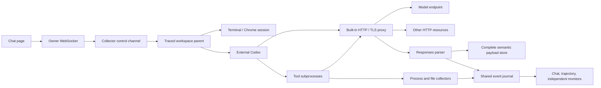

# Agent chat and tool evidence

## First implementation

The Playground offers Chat alongside Terminal and Browser. Chat launches the externally installed Codex executable inside the existing traced sandbox. Each conversation permits one active foreground task and supports subsequent turns through `codex exec resume`.

Model semantics come from observed Responses HTTP requests and SSE or WebSocket messages. The collector reads allowlisted correlation environment variables at successful exec. Codex session and rollout files are excluded from file-content previews. The launcher uses the CLI stdout `thread.started` control notification to retain the conversation ID.

Model and tool records are grouped using transport request IDs and Responses IDs, including successive responses on one WebSocket connection. Process attribution retains its separate inferred provenance.



## Installation and configuration

The server discovers the native Codex distribution through PATH or an npm installation under `/opt/nvm`. The distribution is read-only mounted into the sandbox, including the Code Mode host and supporting resources.

For each session, `config.toml`, named `.config.toml` profiles, `auth.json` and `models_cache.json`, when present, are copied from the external `CODEX_HOME`. Configuration is staged inside the container before the workload starts. Codex receives a private writable home under `/records/codex`, initialized before the terminal starts. Terminal and Chat share this home, the mounted Codex executable path, CA settings and the box-owned TCP egress. The host configuration remains the source for subsequent sessions. Configuration is read into a bounded in-memory snapshot and transferred over Docker stdin without host staging files. The private home, native continuation state, control socket and evidence share container tmpfs and disappear when the sandbox is destroyed. The sandbox root user can read this authentication copy. Host keychain-backed authentication and absolute host paths referenced by configuration require their resources to be made available separately.

Codex runs with approvals and its additional command sandbox disabled inside the existing AgentTomo Docker sandbox. The AgentTomo tracing, network redirection and temporary CA trust still apply. The existing model choice and provider configuration are reused. HTTP capture is enabled automatically when an external Codex installation is available.

`run --proxy http://host:port` and `playground --proxy http://host:port` configure the box's TCP outbound connector. The connector reuses the existing HTTP Host / TLS SNI inspector on a bounded client preface. A recognized hostname selects `CONNECT hostname:original-port`, allowing the upstream proxy to resolve the name. Missing names, unknown protocols and server-first connections retain `CONNECT original-IP:port`; inspection waits at most 500 ms and buffers at most 64 KiB. Shared replay I/O preserves the inspected bytes. Explicit application proxy CONNECT or absolute-form HTTP requests keep their original proxy endpoint. This does not change DNS configuration or recover a DNS failure that prevents the application from connecting at all. Hidden SNI and prefaces exceeding these limits retain IP routing.

After CONNECT, the connector forwards arbitrary TCP bytes. Original socket destinations, recorded five-tuples and process attribution remain intact. HTTP/TLS content capture is independent, and transport CONNECT headers are not recorded as application requests. With this option, inherited application proxy variables are removed; Codex and its tools use their original destinations. Proxy errors never fall back to direct. This milestone supports unauthenticated HTTP CONNECT upstreams; UDP is unchanged.

A host-loopback proxy is reached through the existing temporary TCP relay bound to the Docker bridge. The relay accepts only registered, owned sandbox container addresses and closes with the Playground server. The setting crosses container bootstrap in memory, rather than entering Codex configuration or environment. Hyper's upgraded stream preserves prefetched bytes for server-first protocols and half-close behavior.

Playground also reads an optional `.agenttomo/playground.json` relative to its working directory. This ignored local file persists the proxy across clean shells.

```json
{"proxy":"http://127.0.0.1:8118"}
```

The explicit `--proxy` option takes precedence. Playground retains host proxy variables and then this file as compatibility fallbacks, but they now configure the box rather than the application. Conflicting nonempty URLs fail with instructions to choose one using `--proxy`. An explicitly empty proxy variable disables the file fallback. With no configured override, the default is `http://127.0.0.1:8118`. `--no-proxy` selects direct box forwarding. A configured box proxy applies to all intercepted TCP, without NO_PROXY routing. Plain `run` uses its explicit option or the same default, without environment/file fallbacks.

```bash
sg docker -c './target/debug/agenttomo-box playground --proxy http://127.0.0.1:8118 --listen 0.0.0.0:18889'
```

CLI stdout supplies thread lifecycle and immediate runtime diagnostics, including `error` and `turn.failed`. These diagnostics update the task while Codex retries, with authentication and connection hints plus expandable original details. Nonzero exits always carry an error message even if stderr is empty. Model and tool contents continue to come from observed traffic. Chat shows the current phase and elapsed time, and permits drafting the next prompt while a task is running.

## Events and retained contents

The event category is `agent`. Records include a task ID, Agent instance ID, HTTP request ID and capture timestamp when applicable.

| Logical record | Raw updates | Evidence |
| --- | --- | --- |
| Task | `agent.task.started`, `agent.task.diagnostic`, `agent.task.finished`, `agent.task.rejected` | Submitted prompt, live runtime diagnostics and execution outcome |
| Model call | `agent.model.request`, `agent.model.started`, `agent.model.complete` | Full decoded request and final response object, response ID, usage and status |
| Tool call | `agent.tool.started`, `agent.tool.call`, `agent.tool.result` | Complete model-visible parameters and returned content |
| Assistant message | `agent.message.delta`, `agent.message` | Streaming text and complete final message |
| Capture issue | `agent.capture.error` | Unsupported, malformed, incomplete or oversized protocol data |

`agent-payloads.bin` stores complete JSON-encoded semantic values. Journal records reference byte ranges. The authenticated `agent-payload` endpoint applies the same session-directory and no-symlink checks as existing payload endpoints. The network preview prefix and stream sliding window do not determine semantic retention. Forwarding preserves the original bodies.

Responses custom tools include Code Mode source text. Function tools retain their complete argument string. Outputs found in later model requests are joined using the model call ID, with duplicates from repeated conversation history removed. Native or provider-side tool records are retained when present in Responses output. Returned fields are shown when the protocol exposes them.

Code Mode can call multiple inner tools and choose which values to return to the model. The outer call's observed input and output are available. Inner outputs omitted from the model protocol remain unavailable. A missing return is explicitly shown in the tool inspector.

## Process association

The core identity is `(PID, process_instance_id)`. AgentTomo tool IDs are generated independently of model and Codex execution IDs.

1. The launcher seeds `AGENTTOMO_AGENT_ID` and `AGENTTOMO_TASK_ID` in the Codex process environment.
2. At successful exec, the tracer reads only these identifiers, `AGENTTOMO_TOOLCALL_ID` and `CODEX_TOOL_CALL_ID` from the environment.
3. An explicit AgentTomo tool ID is used when supplied. Otherwise a new worker binds to the active model-visible call at process birth, or at its first applicable exec. Fork-only workers are covered.
4. The binding is stored in the tracer's shared runtime map and retained across later execs. Forked processes inherit it. A later discovered Codex execution ID is recorded as an external alias.
5. Codex runtime executables retain task-level bindings without a tool assignment. This small executable-role rule resides in the Codex adapter.
6. Network and file records acquire their process's binding. Shared socket ownership remains subject to the existing network attribution rules.

The active fallback is released when the corresponding model-visible tool return is observed. Existing process bindings and their descendant inheritance continue to identify that tool.

Stopping a task uses pinned Linux pidfds to signal its observed processes and catches later descendants in the same task scope. The terminal remains available. A process that changes to an identity the collector cannot signal produces a visible error and remains traced.

Bindings use `explicit_environment`, `inferred_process_birth`, `inferred_active_call`, `inherited_explicit`, `inherited_inferred` or `agent_runtime` provenance. The fallback does not inject a tool ID into the target's environment. Its frozen process map provides descendant inheritance.

An older yielded Code Mode cell may start a new process after a newer call becomes active. Initial fallback attribution can then be ambiguous. Inferred and inherited-inferred edges remain visibly marked. Processes without a tool binding appear directly under their task, preserving process parentage and resource children, including internal network requests whose exact tool ownership is unavailable.

## Views and limits

The trajectory is a collapsible tree of tasks, model calls, tools, processes and resource cards. TCP flows contain HTTP exchanges. Existing network aggregation, filters, file preview and the raw event inspector are reused. Process nodes start collapsed. Tool details show complete request parameters and returned content in peer sections, each with collapse and copy controls.

Chat and trajectory presentation retain DOM nodes by stable IDs. Live updates reconcile content and order without replacing pressed/focused controls. Every trajectory card has a left disclosure arrow, including cards with no children, and a right evidence inspection icon. Evidence controls are disabled until an underlying event is available. Clicking the card or arrow toggles children. Final-answer message nodes are omitted from the trajectory, and their complete response remains accessible through the model call inspector. Chat uses consistent headers and one assistant card with the execution/status/error disclosure below the answer. Elapsed time is shown once in that footer.

Sibling nodes are ordered by their recorded start time, with journal sequence breaking ties. Messages retain their first observed time as later deltas and completion update the same node. Model calls are numbered chronologically as `Model call N`, including requests with `generate:false`. Selecting a model call shows its request and final response in peer sections. A response arriving while the inspector is open updates the response section. Recordings made before complete-response retention explicitly report the missing payload rather than reconstructing it from separate tool and message events.

HTTP CONNECT uses its original authority-form target (`host:port`) and omits `scheme`. HTTP requests observed inside the tunnel retain their own HTTP/HTTPS scheme. Older CONNECT URLs are normalized for display without rewriting their raw evidence.

Chat groups messages and tool calls by their observed model request/response membership. Each response has a card labeled with the same chronological Model call number as the trajectory. Text and tools retain their first-observed order within that card, and tools are indented. A result carried by a later request updates its original tool card. Evidence without an observed model owner appears under Unassigned events until that ownership becomes available. Tool cards start collapsed with a parameter preview, capture status and observed elapsed time. Expanding a card loads complete parameters and returned content through the existing payload endpoint. The inspect icon selects the same tool in the trajectory and full detail panel. Tool elapsed time includes the interval between the observed call and model-visible return, including Agent scheduling.

Stable message and disclosure nodes survive streaming updates. Following pauses when the reader scrolls into history, and Latest resumes it. Stop immediately enters a pending cancellation state while the collector completes cancellation. A failed or rejected task restores its prompt when the input has no newer draft. Original error details remain independently expandable.

Each task has a right-aligned question with a right-aligned You label, and one left-aligned assistant card. Headers, content and bottom copy/inspect toolbars use separators and distinct surfaces. Message timestamps appear at the right of the bottom toolbar. Running response cards stay together in the expanded execution area. A response containing the final answer appears above the execution footer, retaining any tools from that same response. Response copy actions copy the original message Markdown in that response. The execution footer shows current state, observed tool count and elapsed time, with a spinner while running and a green dot after success. Tool cards expand into complete parameters and returned content.

Execution starts expanded while running. Successful completion closes it once, keeping the final answer visible; subsequent updates preserve manual disclosure state. Final answers use the model's `final_answer` phase. For recordings without phase labels, only the last message of a successfully completed task is treated as its final answer. Failed and interrupted tasks keep their partial response and error visible and do not use the completed state.

Streaming text is appended to stable text nodes; completed messages render Markdown through locally bundled marked and DOMPurify. Only passive formatting and links survive sanitization. Copy uses original Markdown, preserving the captured content. All content-copy controls show a checkmark after success and restore their icon after two seconds or when the pointer leaves.

Stopping one task leaves the sandbox usable. Losing the owning WebSocket ends the sandbox under the existing session lifecycle. Chat explicitly reports that ended state and offers New sandbox, rather than remaining at Waiting for the sandbox. The draft stays editable and is carried through the reload in per-tab session storage, then removed from storage. After confirmed container deletion, the entire session directory (including journals, semantic payloads and configuration staging) is destroyed. Monitor pages stop following when the recording disappears; no post-session replay is retained. A removed sandbox and its running task cannot be resumed.

Trajectory parent cards pulse when newly captured visible activity arrives beneath them, including collapsed processes, tools, model calls and tasks. Activity uses journal sequences across semantic and resource records. The pulse expires after 800 ms across redraws, and expanding an old branch preserves its activity age.

Owner and independent monitor pages project the same journal using separate cursors. A monitor cannot start tasks or own the container.

| Resource | Limit |
| --- | --- |
| Submitted prompt | 8 KiB UTF-8 |
| Decoded model request, model SSE event, semantic payload | 32 MiB each |
| Zstd decoder window | 64 MiB |
| Semantic payload budget | 512 MiB per run |
| Trajectory resource history in the browser | Latest 20,000 records, with an omission notice |

Payload limits produce an explicit unavailable status. Complete resource events remain in the session journal beyond the browser history window. Other model protocols and exact tool attribution for long-lived Agent internals are subsequent milestones.

## Verification

The deterministic browser integration uses the real external Codex with a local Responses server. It exercises multiple tool rounds, a resumed turn, request decoding, parameter and output details, process/file/HTTP association, independent monitors and container cleanup. It makes no remote model requests.

```bash
cargo test -p agenttomo-box --bin agenttomo-box
cargo test -p agenttomo-box --test http_capture
node --test crates/agenttomo-box/tests/agent-model.test.mjs
AGENTTOMO_PLAYWRIGHT_MODULE=/path/to/playwright-core/index.mjs \
  node crates/agenttomo-box/tests/agent-chat.browser.mjs
```

The browser integration expects the tools image, Docker access and a Chromium CDP endpoint at `http://127.0.0.1:19222`, configurable through `AGENTTOMO_CDP`.
