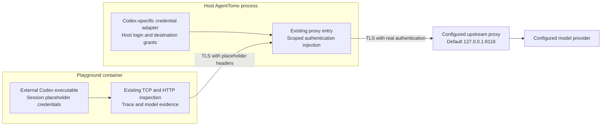

# Codex credential isolation

## Objective

Keep the host's Codex access token, refresh token, signed identity token, and API keys outside the Playground container. Reuse the external Codex executable and configuration while retaining HTTP capture, model responses, tool-call association, and the existing conversation UI.

The UI checkpoint is available on `dev` at `d6c6278`. This milestone implements credential isolation for Playground's file-based Codex login and API-key configuration.

## Previous data flow

`agent::codex::Installation::snapshot` copies `auth.json` into the session bootstrap and copies `OPENAI_API_KEY` and `CODEX_API_KEY` into `agenttomo-environment.json`. Container initialization writes these files into `/records/codex` on tmpfs. Temporary storage limits persistence, while the running container can still read the credentials.

The HTTP inspection proxy runs inside the container. Its header recorder preserves request headers. Injecting credentials in that process would bring them into the container's memory and recording path.

`playground::agent_egress` provides a host-side entry for the configured upstream proxy and tracks the IP addresses of owned containers. Credential forwarding reuses that entry.

## Implemented boundary

The host AgentTomo process owns the real credential material and performs authentication injection after traffic has left the container. Codex continues to issue requests to its configured destinations. The container recorder sees the session placeholders.

Host TLS termination uses an ephemeral signing authority. Its public certificate crosses bootstrap in memory and is appended to a container-local CA bundle at `/records/control/upstream-certs.pem`. The collector loads this bundle through `SSL_CERT_FILE`. Private signing material and real authentication values live in the host process. The workload uses the existing task CA in its temporary trust overlay.

## Codex adapter ownership

Installation discovery, configuration sanitization, authentication extraction, synthetic identity metadata, and provider destination rules remain under `agent::codex`, behind the shared agent adapter interface. `proxy::credentials` owns random placeholders, scoped header grants, reloadable header sources, revocation and the host gateway. The adapter supplies exact allowed methods and paths; the gateway does not interpret Codex login or provider configuration. Provider names, Codex authentication field names, and ChatGPT endpoint policy belong to the adapter.

The implementation reuses the existing HTTP CONNECT connector, TLS authority, opaque byte-stream forwarding, and Playground session lifecycle. Container capture and host forwarding share the HTTP framing, request sending, Upgrade handling, and shutdown implementation in `proxy::http::transport`. Request and response bodies pass through Hyper body frames. The host forwarding entry runs in the existing AgentTomo process and uses one listener for its owned sessions.

### Configuration and placeholders

- Parse the host authentication record in host memory and construct a fresh sandbox authentication record from permitted metadata.
- Replace access tokens, refresh tokens, signed identity tokens, and API keys with session-local placeholders. Synthetic JWTs contain allowlisted identity metadata, a future expiry, and a random placeholder. This lets Codex load its authentication state and avoids scheduled refresh of a placeholder. The host checks the actual access token's expiry.
- Parse TOML configuration to locate static bearer tokens and configured authentication headers. Credential-bearing configuration must be sanitized before bootstrap serialization.
- Resolve supported credential environment variables on the host and give Codex placeholder values in its private environment snapshot.
- Audit the resulting TOML and JSON files before sending them to Docker. Check filenames, field names, values, and decoded placeholder claims against original credential material. A remaining credential stops session initialization with a credential-free error.
- Preserve protocol metadata headers such as Content-Type and Content-Encoding so capture can keep interpreting compressed model requests.
- Report unsupported authentication mechanisms before passing their material into the container. The first milestone covers the existing file-based ChatGPT login and API-key authentication. Other credential stores and provider authentication flows require explicit support.

The approved direct dependencies are `toml` 1.2.1 and `base64` 0.23.1. They provide TOML parsing and Base64URL encoding and decoding for synthetic JWT envelopes.

### Scoped injection

Each authentication grant is bound to its Playground session, owned container, expected placeholder, destination origin, HTTP method, and API operation. The host checks the CONNECT destination, TLS name, and HTTP authority before replacing a header. Model operations include model discovery, Responses over HTTP or WebSocket, and compaction. The ChatGPT adapter also allows the account-check, settings-read, plugin discovery, MCP, and analytics operations observed in Codex CLI 0.167.0. The operation list lives in the Codex adapter. New authenticated operations need an adapter update.

TRACE and unrelated endpoints cannot use the grant. This prevents a sandbox from using a header-echo endpoint to recover an injected credential. Redirect responses pass to the client and a subsequent request is checked against its own destination and operation.

Streaming request and response bodies pass through incrementally. SSE responses and WebSocket upgrades keep their existing streaming behavior. The host authentication layer records operational failures using credential-free diagnostics. Real header values stay outside the container's HTTP recorder and semantic event pipeline.

## Lifecycle and refresh

Create session placeholders and authentication grants before container initialization. Register the owned container's source addresses before allowing tasks to start. Remove the grants and cancel their active connections during normal session cleanup, startup failure, browser disconnect, and server shutdown.

The host authentication source is read-only. Each authenticated request reloads the host file, so an externally refreshed login for the same account can serve subsequent requests. An expired access token returns an actionable error asking for host reauthentication. An account change requires a new Playground session. Refresh-token rotation remains owned by the external Codex login workflow.

This milestone covers Playground's external Codex authentication. Provider authentication commands, gateway OAuth, personal-access-token records, Bedrock credentials, and credential-bearing MCP configuration produce explicit unsupported-configuration errors before bootstrap. An arbitrary credential already baked into a custom image or manually entered by a user is outside this adapter's input boundary.

## Acceptance criteria

- A real Codex task completes through the default upstream proxy and produces model, tool, process, file, and network evidence.
- Container files, bootstrap bytes, process environments, arguments, request headers, and diagnostic records contain no original host tokens or API keys.
- Placeholders from another session, mismatched destinations, altered HTTP authorities, and unsupported authentication configurations cannot obtain a real authentication header.
- SSE and WebSocket streaming remain incremental. Cancellation and a subsequent task work in the same session.
- Closing the owning page removes the container and its authentication grants. Existing multiple-monitor behavior remains usable.
- The host's Codex authentication and configuration files keep their original contents.
- Expired credentials produce an actionable error without disclosing credential material.

## Investigation evidence

The installed Codex CLI is version `0.167.0`. The final real Playground check completed in 42 seconds with four model calls, two tool calls, an HTTPS request through the configured upstream proxy, and zero task TLS errors. Host-side checks inspected 94,822,400 bytes of sandbox records plus process environments and arguments and found no original login tokens. The external authentication file passed a byte-equality check after the task. Container cleanup passed after closing the owning page. The scan keeps its original credential values in host memory and streams sandbox data out for inspection.

Local forwarding tests cover HTTP and HTTPS injection, response streaming before completion, WebSocket messages in both directions, server-first opaque TCP, half-close behavior, and active-stream revocation. Negative cases include wrong session markers, malformed authorities, unrelated and ambiguous paths, TRACE/header echo, malformed identity metadata, unsupported authentication, and credentials accidentally present in other configuration fields. The deterministic browser test verifies upstream authentication, captured evidence, cancellation, reconnection, and read-only host authentication.

Final verification passed 173 default Rust tests, all 17 opt-in Docker and OverlayFS tests, 75 frontend unit tests, deterministic browser checks, and the real Codex check. Formatting, whitespace validation, and the debug build passed.

Official documentation describes file-based login caching, automatic ChatGPT token refresh, and custom CA support. It also describes routing model traffic through a gateway. [Authentication](https://learn.chatgpt.com/docs/auth), [Connect to a gateway](https://learn.chatgpt.com/docs/enterprise/connect-to-a-gateway)
