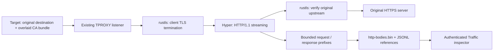

# Content inspection

The approved traffic/file prototype lives in `docs/demos/traffic-inspector/`.
Production work is incremental. The existing process tree, filters, terminal,
event JSON details and network forwarding remain available.

## Delivery order

1. **File previews (implemented):** associate bounded content snapshots
   with real `file.open` events, display text/JSON/hex and copy displayed content.
2. **HTTP/HTTPS slice (implemented):** HTTP/1.1 request/response capture and a
   traffic inspector using real records; TLS interception with a task CA
   injected through OverlayFS. These parts form one verifiable HTTPS path.
3. **Live streams (implemented):** SSE/WebSocket inspection with a byte-bounded sliding window that removes
   the oldest payloads and indexes together.

Content capture is opt-in with `--capture-http` on `run` and `playground`.
Without that flag, existing passive HTTP Host / TLS SNI forwarding is unchanged.

## HTTP/HTTPS contract

The existing transparent listener still receives the original destination and
PID association. HTTP parsing and TLS termination are separate proxy modules;
neither depends on ptrace internals. Hyper handles HTTP/1.1 framing, keep-alive,
chunked messages and upgrades. rustls/tokio-rustls handle both TLS connections;
rcgen signs site certificates, with DNS or IP SANs. The collector loads its
native trust roots **before** the target's filesystem is overlaid and verifies
upstream identity/certificate chains. An upstream verification or client
handshake failure is recorded as `network.tls.error`; no insecure retry or
silent encrypted fallback occurs. The handshake has a shared 15-second budget.

Each capture-enabled run generates a fresh CA named `AgentTomo Root CA`, valid
for ten calendar years. February 29 anniversaries fall on February 28 when
needed. Root and leaf keys stay in collector memory. The public PEM crosses the
existing private Unix startup channel in a bounded, length-prefixed message and
is materialized inside the target's tmpfs-backed trust overlay. The ordinary
temporary directory supplies only an empty mountpoint, removed on scope cleanup.
The single-threaded target helper creates a mount namespace owned by its existing
user namespace, makes mount propagation private and mounts a small tmpfs for
OverlayFS upper/work. The overlay covers `/etc/ssl/certs`, preserving lower
entries and replacing `ca-certificates.crt` with the original bundle plus the
task CA. This supports the Debian/Ubuntu system **bundle**; it does not rebuild
hashed CA directories or general Java/NSS/custom runtime stores. The optional
Playground Chrome image has a separate launcher that imports this same public
CA into its disposable container NSS database; see
[Chrome integration](../docker/playground-chrome/README.md). Mounts and upper data
die with the target namespace. Failed setup stops launch with a clear
error and does not run the target. Capabilities are dropped before target exec.

With `--overlay-root`, the helper overlays [eligible top-level directories plus `/etc/ssl`](root-overlay-design.md).
The CA/bundle goes into the private SSL view without a second certificate-directory overlay.
Every trust path, including symlink targets, must actually be covered: paths in skipped directories,
exemptions or read-only mounts fail startup before injection. Other paths retain the original
container filesystem. The existing certificate-directory-only overlay remains the default.

Domain certificates last one day, with a five-minute allowance before issuance
for clock skew. Their CN names the certificate identity. A run-local Moka cache
holds shared TLS configurations with a fixed one-hour TTL from insertion and a
configured maximum of 1,024 entries. Concurrent requests for the same identity
share one signing operation. Expired entries are regenerated on the next use.
Active TLS connections own their configuration for their connection lifetime.

The PSL library, including private suffixes, determines safe wildcard groups.
`www.baidu.com`, `a.baidu.com` and `baidu.com` share SANs `*.baidu.com` and
`baidu.com`. `x.a.baidu.com` uses the `*.a.baidu.com` group. A tenant such as
`alice.github.io` groups within `*.alice.github.io`. IP addresses, single-label
names and unknown suffixes use exact certificates. DNS cache keys normalize case
and one terminal dot, and IP keys use the parsed address representation. PSL
data updates with the dependency. Upstream verification uses the requested host.

Evidence stores trust-file open metadata with `task_trust_material` as the
preview reason for the injected bundle, task CA and NSS certificate databases/journals.
This keeps automatic file previews from archiving session trust material.
The recorder owns this retention decision. File collectors pin handles and
inspect metadata at syscall exit, and recording applies the trust exclusion
before reading content or publishing a saved preview.
Applications that explicitly print or copy public certificates can still place
that data into their output or other observed resources.



`network.http.request` / `network.http.response` publish headers, method/URL or
status, request ID, connection ID and existing process metadata. Separate
`.request.body` / `.response.body` events publish saved ranges and trailers.
Request IDs distinguish keep-alive exchanges within one connection. Headers
retain duplicate fields and use explicit Latin-1 byte-to-character conversion.
Bodies are entity bytes: HTTP chunk framing is removed, content compression is
not decoded. No unbounded body collection or payload embedding in JSONL occurs.

Default limits are **64 KiB per body** and **64 MiB per run**, configurable via
`--http-body-max-bytes` (0..1 MiB) and `--http-body-total-bytes`; zero disables
body retention while preserving headers and forwarding. A shared budget bounds
both retained in-memory prefixes and the append-only `http-bodies.bin` (0600).
Once a message ends or aborts, its prefix is flushed before a range is published.
Exhaustion stops retention, not forwarding. Empty, truncated, incomplete,
disabled and unavailable captures have distinct metadata. Storage failure does
not fabricate a successful payload reference. Event/header logs are not covered
by the body budget. The API reuses the file preview's authenticated, no-symlink,
bounded range reader, without accepting a user-controlled file path.

`started_unix_ns` is the proxy's receipt of request headers, not body completion
or record-write time. Body events carry actual completion/drop time and elapsed
monotonic duration; response headers additionally carry their receipt time.
`observed_unix_ns` and `monotonic_ns` describe receipt by the recorder before
queueing. `recorded_unix_ns` describes the JSONL write attempt after preview work.
Source start/completion fields describe the operation independently of storage
latency. HTTP start time covers activity from receipt at the proxy onward.

The Traffic tab groups real requests with PID, URL, method and status; selecting
one displays request/response headers and bounded text/JSON/hex body content.
Body copy icons, filtering, truncation/error states and the original event JSON
details remain available. Its live list retains 1,000 exchanges; older records
remain on disk. Event-driven list and selected-detail updates are batched with
`requestAnimationFrame`. Request IDs key reusable DOM rows, with fields updated
only when that request changes. Filtering retains cached rows within the same
1,000-entry bound, and scrolling preserves either history position or bottom
following. Bodies are currently viewable after the message ends/aborts.

Headers and Body use matching sibling section headings. URLs, headers and body
or stream-message text wrap to the available width without changing copied
content. Copy buttons use shared icons with accessible names and tooltips;
the inspector does not display a copy-URL button.

The inspector defaults to **Decoded** and provides **Raw / Hex** for the retained
entity bytes. Following Charles's documented [decompress-on-view behavior](https://www.charlesproxy.com/documentation/configuration/preferences/)
and [compressed-data viewer](https://www.charlesproxy.com/documentation/using-charles/requests-responses/),
the optional `decode` query on the HTTP body range API decompresses gzip, zlib
deflate or zstd with flate2 and the approved zstd dependency, outside the asynchronous runtime.
It does not rewrite recorded payloads or proxy traffic. Output is limited to
1 MiB; `x-agenttomo-decoding` distinguishes complete, incomplete, output-limited,
invalid and unsupported content. Incomplete streams expose only the recoverable
prefix, with an explicit unverified-checksum label. Invalid or unsupported
encodings (including Brotli, Zstandard and encoding chains) return original
bytes with an explanation. The file preview endpoint continues serving raw ranges.
Text rendering respects the HTTP Content-Type charset when supplied; JSON
formatting requires complete, losslessly parsed text. HTML is displayed as text.

### Current limits

- TLS interception advertises HTTP/1.1, not HTTP/2. HTTP/2-only TLS clients fail
  negotiation. HTTP/2 prior knowledge, HTTP/3/QUIC, STARTTLS, ECH, certificate
  pinning and mTLS are not supported for content capture.
- Clients with their own CA bundles, custom `SSL_CERT_FILE` / `SSL_CERT_DIR`,
  Java/NSS stores or bundled roots may not trust the injected system bundle.
  The provided Playground Chrome launcher explicitly handles its NSS store.
- The initial HTTP preface is recognized with httparse, bounded to 64 KiB,
  128 headers and 500 ms after detection begins. Incomplete/unsupported prefaces
  are replayed through the opaque forwarder; unusually slow headers may not be
  captured. This lookahead can delay an ambiguous non-HTTP prefix by up to 500 ms.
- Non-HTTP plaintext streams retain opaque forwarding. TLS is terminated in
  capture mode; non-HTTP TLS protocols are not promised transparent behavior.
- HTTP CONNECT and non-WebSocket upgrades forward opaque bytes after their HTTP
  handshake. Nested TLS inside CONNECT is not decrypted. Successful WebSocket
  upgrades also have a passive message observer; see below.
- No user-supplied framework is patched. Instrumentation is observable (task
  certificates, HTTP/1.1 negotiation, proxy timing); this is not a sandbox
  security guarantee or byte-for-byte preservation of HTTP wire formatting.

## SSE and WebSocket messages

With `--capture-http`, SSE responses and validated HTTP/1.1 WebSocket upgrades
use the existing connection/PID association and TLS interception. HTTPS SSE and
WSS use the same task CA, including strict X.509 clients. Leaf certificates carry
an Authority Key Identifier; certificate verification is never disabled.

The observers consume copies of forwarded bytes. SSE uses `sse-parse` for
incremental UTF-8, CR/LF/CRLF, multiline `data`, event names, inherited IDs and
retry values. Comments are not application events. An unfinished last event is
discarded as required by SSE. Identity, gzip and zlib-wrapped deflate encoding
are inspected; other encodings are forwarded with an inspection-error record.
A 1 MiB parser cap skips oversized blocks and resumes at the next event boundary.
Message retention may truncate an otherwise parsed event to a smaller prefix.

WebSockets reuse tungstenite's frame header parser. Observation removes masks
from its copy, joins data fragments and independently records ping, pong and
close frames, plus text/binary messages. It does not send automatic pong/close
frames, rewrite frame boundaries, remove extension negotiation, or wait for a
whole message before forwarding. Large messages retain only a bounded prefix.
EOF during a fragmented message marks it incomplete. `permessage-deflate` is
decoded in both directions, including context takeover and negotiated context
reset. Unknown extensions retain explicitly undecoded bytes and use hex display.
Malformed framing stops that direction's inspection with an error record; it
does not make the observer a protocol firewall. Decompression uses 8 KiB output
chunks and a maximum 8 MiB expansion per input chunk; exceeding that work budget
stops decoding and leaves forwarding running.

Each message carries its request ID, connection/process metadata, direction,
kind, observed/retained byte counts, truncation and completeness. Start time is
the receipt of the SSE block's first body chunk or the first WebSocket frame
header; completion time is separate. Neither timestamp includes time before the
bytes reach this proxy. SSE sizes count decoded event data, WebSocket sizes count
decoded message payloads (or explicitly undecoded extension bytes); original
network byte totals remain in the existing transfer records.

### Retention and API

Defaults are **64 KiB per message**, **4 MiB payload plus JSON metadata per run**,
and **1,000 messages across all connections**, configured with:

```sh
--stream-message-max-bytes 65536 \
--stream-window-bytes 4194304 \
--stream-window-messages 1000
```

Per-message capture accepts 0..1 MiB; message count accepts 1..10,000. Setting
either byte limit to zero disables stream message retention, not forwarding.
These limits are separate from ordinary HTTP body-prefix limits. SSE does not
also save a non-expiring prefix into `http-bodies.bin`.

`stream-messages.sqlite3` (0600) holds the sliding window. rusqlite uses bundled
SQLite, so containers need no SQLite system package. A bounded 64-message queue
feeds a worker off the Tokio thread, batching transactions. Queue overload drops
observations with an explicit run-wide dropped count. Window eviction deletes
payloads and indexes together; monotonic IDs cannot alias newer payloads. Deleted
cells are cleared (`secure_delete`); freed pages are reused. The byte limit counts
payload plus serialized metadata, not SQLite pages/indexes/journal overhead. The
file may retain its bounded high-water allocation. Storage failure is reported
when the stream/scope flushes, rather than publishing a false successful capture.

JSONL records `network.stream.open` and `.closed` once per stream; message bodies
and indexes are not duplicated into that append-only log. Existing general
event/header logs remain outside the stream window budget.

The token-authenticated `/api/sessions/{session}/stream-messages` endpoint reads
a consistent snapshot for a `request_id`; adding `message_id` reads one bounded
payload. Paths are fixed, session/IDs are validated and symlink components are
rejected. Missing/expired message IDs return 410, never a different payload.

### Live presentation

Traffic labels these exchanges SSE or WS with live/closed state. Request and
response headers and the original event JSON detail remain available. The
Messages tab polls the selected visible stream every 250 ms and displays time,
direction, event/message type and size, with text/JSON/hex content and copy.
Scrolling up or selecting an older message pauses following; `Follow latest`
resumes it. Expired selected payloads are removed and labeled. Async fetches are
cancelled when selection changes, and hidden views do not poll. Window eviction,
overload loss, unsupported decoding and incomplete/truncated captures are visible.
The 1,000-exchange live list prefers evicting ordinary/completed requests before
active streams; if all 1,000 entries are active, the oldest is still evicted to
keep the UI bounded. Stream message retention remains a separate run-wide budget.

Verification includes actual Chrome EventSource and compressed WebSocket traffic,
live data before EOF, authenticated retrieval/expiry, scroll/copy/tab behavior,
TLS-wrapped SSE/WSS, byte-preserving transfer, compression/fragments/control
frames, parser overflow recovery and bounded storage reuse.

## File preview contract

The preview is a best-effort prefix snapshot of a successfully opened object.
Capture starts when the persistence worker reaches that event, so queued I/O
can delay the read and concurrent writers can change the content. The saved
capture timestamp identifies that later observation. Application reads require
separate evidence. Clicking the preview loads the saved bytes.

At syscall exit the collector pins the opened object via its known `/proc` FD,
checks its type/filesystem, and obtains an independent read handle. The recorder
queues this handle alongside other events in a bounded 256-item FIFO. One Tokio
worker owns preview reads, payload persistence and ordered JSONL writes. Payload
ranges become visible only after their writes succeed. Queue saturation applies
backpressure, and event-write failures propagate to collection status.
Renaming/unlinking/replacing the path after open cannot select a different inode,
and the application's file position is not advanced. No FD-table scanning or
additional target syscalls are introduced.

Root-exit acknowledgement flushes standard streams independently of this worker.
Normal collection completion waits for all queued events and previews to drain
and for JSONL flush to finish. Consumers should use `collection-status.json`
to distinguish a complete recording from a foreground command that has returned.
`recorded_unix_ns` marks the write attempt, with flush completion represented by
collection status. File opens and mmap use shared operation timing captured at
syscall entry/exit, including `started_unix_ns`, `completed_unix_ns`,
`duration_ns` and `start_source=syscall_entry`.

Capture only readable regular files on local filesystems (ext, XFS, Btrfs,
OverlayFS, tmpfs, ramfs and SquashFS). Do not read directories, devices, FIFOs,
sockets, procfs/sysfs, remote/FUSE filesystems, write-only or O_PATH handles.
Permission/read/storage failures produce an explicit unavailable state and do
not replace the open result. Empty snapshots remain distinguishable from missing
snapshots. No capabilities or permissions are added to bypass failed reads.

Defaults: 64 KiB per preview and 64 MiB per run. CLI options
`--file-preview-max-bytes` (0 disables, maximum 1 MiB) and
`--file-preview-total-bytes` configure those limits for `run` and `playground`.
The budget bounds stored payload bytes, not existing event metadata or filesystem
I/O latency. Regular-file reads can still involve disk I/O. An exact-content cache
reuses saved ranges for identical prefixes, so repeated library/configuration
opens do not repeatedly consume the budget. The cache uses the existing Moka
dependency with a 16 MiB weight limit (content plus estimated entry overhead),
independent of the configured disk budget. It compares the newly read bytes, not
paths or timestamps; changed prefixes get new ranges. Cache eviction may cause a
later identical prefix to be saved again. Historical ranges remain immutable.

The recorder appends payloads to `file-previews.bin` (0600) in the run directory.
`file.open.data.preview` records status, source, original size, captured bytes,
byte offset, capture time and truncation. References are published only after
their payload write finishes. A read/storage error stops that preview; the
existing event log still records the open. Reused ranges have `reused: true` and
retain each event's own capture time, size and truncation state. Once the budget
is exhausted, cached identical prefixes and empty files remain available; new
nonempty content is marked unavailable without stopping collection. Unavailable
snapshots from earlier runs cannot be reconstructed from those recordings.

The authenticated Playground API serves only bounded ranges of the retained
snapshot file. Session identifiers and offsets are validated, all directory/file
components are opened without following symlinks, and responses use `no-store`
and `nosniff`. It never accepts an arbitrary target or host pathname. Snapshots
remain viewable after the process/container exits while the page/server remains
available.

## Presentation

Selecting `file.open` opens a separate file inspector; the original expandable
event JSON details remain below it. Text has line numbers, JSON has pretty/raw
views, and binary/invalid UTF-8 uses hex/ASCII. All file content is rendered as
text. Loading/error/unavailable/empty/truncated states are explicit.

The copy icon copies displayed content (hex for binary) from the current preview;
it never implies that truncated bytes are the whole file. The close and copy
icons retain accessible names and hover hints; there is no copy-path button. Clipboard failures are
reported and HTTP previews have a browser copy fallback. A stale asynchronous
fetch must not replace a newly selected file. Existing records without preview
metadata show that content was not captured.

## Alternatives

Reading a pathname when the user clicks is simpler but can display a replacement
file or fail after process exit. Embedding bytes in every JSON event inflates
logs, live frames and the process tree. Pinning the opened object and retaining
bounded, separate payloads gives stable event-to-content association without
coupling the file collector to HTTP proxy implementation.

## Verification

Test real open/read/rename/unlink behavior and independent file offsets; byte
limits and exhausted budgets; failed/write-only/device/pseudo-file opens;
authenticated bounded retrieval and symlink rejection; UTF-8/binary formatting;
clipboard success/failure; stale selection; and preservation of raw event details.
Run focused checks before the Rust and browser regression suites. Do not start
a preview service on port 18889: the user requested that it be released.
