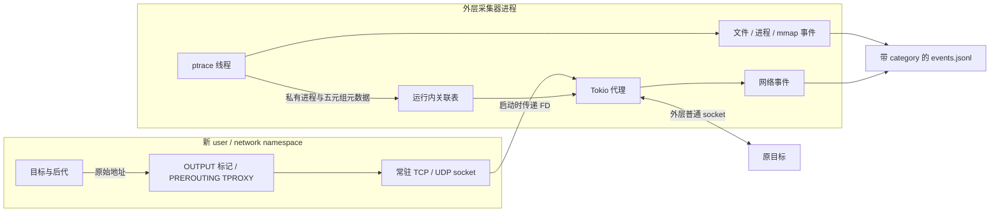

# 文件与 TCP 采集

当前网络后端为 namespace + netfilter TPROXY + 同进程常驻代理。旧版 ptrace 改写 connect、每连接 listener 和 getpeername 还原已移除。UDP 详见 [UDP 采集与转发](udp-collection.md)，内存映射详见 [mmap 采集](mmap-collection.md)。

## 模块与数据流

- `network/namespace.rs`：单线程启动 helper 创建 user/net namespace、配置路由与 iptables/ip6tables，把监听及回包 FD 通过 SCM_RIGHTS 交给外层采集器。只操作新 namespace；不修改宿主规则，也不需要 TUN、veth 或 FUSE。
- `network/socket.rs`、`packet.rs`：透明 socket、UDP 原始地址控制消息与回包封装。
- `collectors/network/`：只维护私有的 socket 身份、地址和调用者元数据，不发布 `network.*` 事件，不改写应用的网络目的地址。
- `network/association.rs`：一次运行内的五元组关联表，不做全局进程/socket 扫描。
- `proxy/tcp/`、`proxy/udp/`：独立的 Tokio 转发与网络事实记录，均在采集器同一个 Rust 进程内。上游 socket 属于外层网络 namespace，不会再次命中内层规则。
- `syscall/`、`tracing/`：选择性 seccomp 停点、ptrace 状态机和寄存器/内存机制；不实现代理协议。
- `collectors/file/`、`collectors/memory/`：独立解释文件与映射事件。
- `recording/`：统一分类、序号、时间和落盘；Web 消费同一事件格式。

每个诊断作用域固定创建 IPv4/IPv6 各一个 TCP listener 和一个 UDP 接收 socket；不是每连接新建 listener。TPROXY 不改写报文两端地址：TCP `accept` 的 peer 和 `getsockname` 分别给出原始源端点和目的端点。完整 key 为协议、源 IP/端口、目标 IP/端口，关联表按运行独立，相同源端口访问不同目标互不冲突。相比 REDIRECT，无需依赖 NAT 后源端点反推 conntrack 原元组。

启动前检查外层 IPv6 路由：如果没有任何非回环单播路由，内层不添加 IPv6 默认路由，但保留 IPv6 回环及代理 socket。这样应用在 IPv4-only 环境内尝试外部 IPv6 会立即获得不可达错误，可正常回退 IPv4，避免先与本地代理完成 TCP 握手后才遭遇重置。外层有 IPv6 路由时沿用原来的 IPv6 转发；目前不动态同步外层路由变化。

## 启动要求与失败行为

运行环境需允许创建 user/net namespace、在其内部使用 NET_ADMIN/NET_RAW、安装 seccomp、跟踪自启动子进程及读取其 `/proc`。必须有 `ip`、`iptables`、`ip6tables`，内核支持 IPv4/IPv6 TPROXY、socket match 和策略路由。程序也会在 `/usr/sbin`、`/sbin` 查找工具，不要求修改 shell 配置。

helper 映射调用者原 UID/GID，临时能力只属于新 user namespace；配置完毕后清空 capabilities 与 bounding/ambient 集合，启用 no_new_privs，再释放用户命令。网络或跟踪初始化失败以 125 退出，报告原因，不执行用户命令，也不退回 ptrace 重定向。这里的 namespace 是网络后端必需条件；挂载 namespace、OverlayFS 仍是独立的可选能力。

Docker 默认 seccomp/AppArmor 可能禁止嵌套 namespace。Playground 开发容器设置 `seccomp=unconfined`、`apparmor=unconfined`，同时保留 `cap-drop=ALL`、当前 UID/GID 和 no-new-privileges；不添加 privileged，不修改 Docker daemon。这个开发配置放宽了容器安全策略，不能当作恶意代码隔离方案。

## 进程归属

socket 成功创建时，读取该已知 FD 的 inode 并分配运行内 socket ID。fork/dup 后同一 inode 可以继续识别；不会遍历全部 FD。connect 入口只有目标地址，自动源端口尚未确定，因此在成功或 EINPROGRESS 出口临时执行一次 getsockname 查询，再完整恢复原返回值、寄存器和借用的栈字节。查询期间通过 PTRACE_SETSIGMASK 临时阻塞可屏蔽信号，由内核保留待交付信号及 siginfo；恢复原信号掩码后正常交付，SIGSTOP/SIGKILL 仍按内核语义处理。FD 被其他线程关闭/复用时放弃归属。

代理接受连接可能早于元数据登记，最多等待 250 ms。未取得可靠元数据仍转发，标记 `attribution=unavailable`，不猜 PID。TCP 的 `attribution=connect_initiator` 表示建连发起者，不宣称它就是共享 FD 后每一次 write 的执行者。PID、稳定的 `process_instance_id` 和 `socket_id` 随代理事件保存，迟到的事件不会复活已退出进程。同进程线程共享该身份；线程号仅保留在底层 ptrace 操作内。

## 事件与应用可见行为

- `network.upstream`：代理实际连接原目标的结果。
- `network.protocol`：默认模式读取 HTTP/1 Host/请求目标 authority 或 TLS ClientHello SNI；仅解析前 64 KiB，HTTP 最多 128 个头。支持分段，畸形、未知或超限前缀不阻断转发。默认 TLS 不解密，域名是客户端声明，不恢复 ECH 隐藏名称。开启 `--capture-http` 后使用独立 HTTP/TLS 模块，记录 `network.http.*`、正文范围和 `network.tls.error`，具体限额与 CA 注入边界见[内容检查设计](content-inspection-design.md)。
- `network.transfer`：转发结果、上/下行字节数；无法确认的计数为 null。

上述事件来源均为 `tcp_proxy`，`category=network`，携带原始 `source_address`、`destination`、协议与 connection ID。ptrace 不再输出 network.connect、getpeername 或网络收发事件。失败且未到达代理的系统调用不是出口流量记录，不能从无事件推断应用没有尝试调用。

应用的 connect 参数及 getpeername 返回值保持内核原行为，不再看到重写的代理目的地址。不过目标运行在只有 lo 的新网络视图，外部服务看到的是代理出网地址/端口；TCP 仍是两段连接，远端失败可能表现为后续 EOF/reset，TCP_INFO、接口绑定、MTU、错误队列和 socket 选项不等同于原网络。当前内层 loopback 已有目标 socket 时直接由内核处理，保留命令自建 TCP/UDP 服务互访；没有内层目标 socket 的流量交给外层代理（包括外层 DNS/loopback 服务）。内层互访不是出口代理事件。入站服务、广播/组播及主动切换网络 namespace 不属于支持范围。外部传入 FD、io_uring、TCP Fast Open 等归属路径未作完整保证。

## 转发汇总时间

`network.transfer` 与 `network.udp.transfer` 在收尾时才有完整字节计数，但事件的业务开始时间单独记录：TCP 在代理 `accept` 返回时取时，UDP 在代理收到该流的第一个数据报时取时，均早于关联查找与后台任务排队。字段为 `started_unix_ns`、`completed_unix_ns`、`duration_ns` 和 `start_source`（`proxy_accept` / `proxy_first_datagram`）。耗时使用单调时钟计算；这是代理连接/流的寿命，不是 HTTP 请求或目标 `connect` syscall 的开始时间。

`observed_unix_ns`、`monotonic_ns` 与 `sequence` 继续保留记录器写入时序。Playground 对新记录优先显示开始时间，并仅在显示层按开始时间排序；结束和写入时间保留在原始详情及时间提示中。旧日志没有开始字段时沿用原记录时间，不推算或伪造开始时间。特别快退出的目标，其排队报文可能在退出后才被代理收到，此时代理开始时间晚于进程退出也是实际观察结果。

## 文件行为与生命周期

文件仍由 seccomp RET_TRACE + ptrace 采集 open/openat/openat2/creat：请求路径及原始字节、dirfd/base_path、flags/mode/resolve、返回 FD 或 errno，成功时补充已知 FD 的路径。读取失败、截断和内核重启码分别标记；不虚拟化文件系统，不把 mmap 当作每次内存读写。

文件预览从成功打开的已知 FD 固定可读普通文件对象，由 recording 异步保存有上限的内容前缀，不在浏览器点击时重读路径。默认 64 KiB/文件、16 MiB/运行，可通过 `--file-preview-max-bytes`、`--file-preview-total-bytes` 调整或设为 0 禁用。快照与 JSONL 分开保存，事件包含范围和完整性状态；它不是 read 调用记录，也不是原子文件快照。支持范围及 Web 读取边界见[内容检查设计](content-inspection-design.md)。

根命令退出时前台返回；ptrace 继续跟踪全部后代。全部目标退出后代理排空已接收的上行数据，停止等待无接收者的下行，落盘后才标记 complete。上游 TCP 建连有 30 秒超时。
