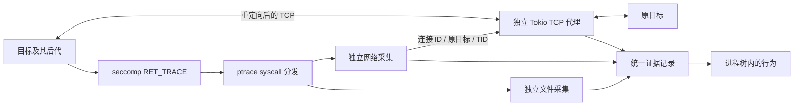

# 文件与 TCP 采集

## 本次交付

在现有 run 和 Playground 中补齐文件打开记录及 TCP 重定向/转发，不改变前台随根进程退出、采集器继续服务后代的生命周期。文件与网络采集模块独立，代理不依赖 ptrace，也不依赖文件采集。

## 模块与数据流

- `syscall/`：seccomp 白名单筛选、系统调用停点信息、目标内存和寄存器适配，只提供机制。
- `collectors/file/`：open/openat/openat2/creat 参数快照与真实返回值、路径记录；不读取文件内容。
- `collectors/network/`：socket 类型识别、connect 参数/结果、为 TCP 建立重定向；不执行异步字节转发。
- `proxy/`：独立的 Tokio TCP 代理；输入是连接 ID、发起 TID、原目标和已绑定的本地 listener，输出为代理连接与传输记录。
- `tracing/syscalls.rs`：分发关心的调用、维护每个 TID 的入口/出口状态；文件和网络模块彼此不引用。
- `recording/`：为各来源记录统一时间和序号；Web 只消费真实记录。

## 采集与拦截规则

使用 no_new_privs + seccomp RET_TRACE 选择 open/openat/openat2/creat/socket/connect，并用 PTRACE_SYSCALL 获取选中调用的退出；其余调用由内核直接执行。过滤器继承到后代，安装失败不执行目标。使用 Linux 5.3+ 的 PTRACE_GET_SYSCALL_INFO；当前后端只采集原生 x86_64 ABI，其他架构保留进程跟踪，不安装此 syscall 过滤器。需要外层允许子进程 ptrace、seccomp 安装、目标 /proc 访问和本地端口绑定；不依赖 eBPF、iptables、额外 capability 或 namespace。no_new_privs 会阻止后续 exec 通过 setuid/file capabilities 获得新权限。

文件记录请求路径与原始字节、dirfd/base_path、打开参数、返回 FD 或 errno；成功后定点读取 `/proc/<tid>/fd/<返回FD>` 补充实际路径。参数不可读/截断要单独标记，不能影响目标的原始文件操作。openat2 记录 flags/mode/resolve，不将其与路径字符串混为一谈。事件在 syscall 退出停点生成；内核信号重启码单独标为 restart，不冒充最终用户态 errno，没有退出停点的调用可能缺少完成记录。这里不宣称覆盖 read/write/mmap、rename/unlink 或 io_uring 文件操作。

网络在 socket 成功返回时登记其 inode 和类型，connect 时仅查询当前已知 FD 的 symlink 并按 inode 查表，不扫描 FD 表；fork、dup、exec 后的同一 socket 因而可以识别。只重定向本次执行中观察到创建的 AF_INET/AF_INET6 TCP socket；UDP、Unix socket、继承自外部的未知 socket 和不同网络命名空间的调用保持原路径，记录原因。socket 元数据随诊断作用域保留，不做全局常驻缓存。

每次 TCP connect 分配一个专属 loopback listener，将原目标与 ID 交给代理。sockaddr 复制到当前线程栈的临时区域，调整调用参数指针；不修改应用原 sockaddr，退出时恢复栈内容及参数。支持只读/共享 sockaddr。失败、信号重启、线程退出都回收未使用路由。

代理先接受被重定向的连接，再异步连接原目标，使用 Tokio 转发，处理半关闭和并发。原始 connect 返回的是目标到本地代理的结果，原目标连接结果另记，不能将两者混为成功；上游失败时目标看到连接关闭/重置。getpeername 会看到代理端点，原 socket 的源端口/接口选项不复制到上游。这是 TCP 代理的可见语义变化，不是完全透明的内核网络仿真。HTTPS 只透传 TLS 字节，不解密、不声称获得 HTTP 请求内容。

代理接受连接及连接上游各有 30 秒超时；只有发起连接的 socket 受该路由影响，tracer 不等待上游网络 I/O。根进程结束不关闭代理；全部 tracee 结束后停止等待向目标下行的数据，仍完成已接收的上行数据转发，再结束记录。异常采集失败或容器删除会取消整个作用域。

`file.open`、`network.connect` 使用 ptrace 来源；`network.upstream`、`network.transfer` 使用 tcp_proxy 来源，结果分别记录，字节计数未知时为 null。各来源共享单次运行的序号与落盘时刻；该时刻不冒充 syscall 的精确开始时刻。进程与行为携带运行内稳定 task_id，fork 另有 child_task_id；代理沿路由携带同一 task_id 和 connection_id，避免进程退出/TID 复用后的错误归属。它们只服务原生任务身份和 TCP 路由，不引入 Agent 工具语义关联。

这种实现需要线程栈临时空间、本地 listener 和每个活动连接的两个 socket，未设计为安全边界。socket 类型缓存随本次运行保留，长时间高连接数诊断会增加内存用量；当前无任务总超时。网络采集不覆盖外部传入的未知 FD、TCP Fast Open、sendto/QUIC、io_uring 等路径；外层过滤器优先拒绝的调用也不会产生 RET_TRACE 事件。

## 验证

文件验证实际成功/失败打开、相对 dirfd、openat2、非 UTF-8 路径、无效地址及信号中断。网络验证 IPv4/IPv6、阻塞/非阻塞 connect、只读 sockaddr、fork/dup 后连接、并发与双向半关闭、UDP 保持直连、上游失败记录、父退出后的后代访问，以及实际数据经过内置代理。保留现有生命周期与 PTY 测试，最后用 Docker 浏览器观察同一节点下的文件和网络行为。

2026-11-05 验证记录：

- `cargo test --workspace`、`cargo fmt --all -- --check`、`cargo clippy --workspace --all-targets -- -D warnings` 通过；默认测试包含 40 项。宿主关闭 IPv6 回环，对应条件用例报告未在宿主执行。
- `cargo test -p agenttomo-box --test playground -- --ignored --nocapture` 的 3 项 Docker 用例通过；`node --test crates/agenttomo-box/tests/process-tree.test.mjs` 的 11 项树模型测试通过。
- 额外在现有 Ubuntu 24.04 镜像内，以 UID/GID 1000、cap-drop=ALL、no-new-privileges 和默认 seccomp 运行静态 C 程序，文件采集成功；IPv6 经代理双向各传输 65,536 字节并校验内容。没有拉取镜像、修改节点权限或使用特权容器。
- 实际浏览器终端读取 `/etc/hostname` 并请求本地验证 HTTP 服务：文件打开与 TCP 连接归于同一 task_id，代理上行 40 字节、下行 139 字节，终端收到完整响应；点击事件能查看原始记录。页面无 JS 异常，桌面事件列无重叠，窄屏无横向溢出。
- 收尾回归覆盖：所有 tracee 结束、下行已关闭且上游暂时背压时，继续排空 256 KiB 上行数据，不让失效下行中断上传。

机制参考：[seccomp](https://man7.org/linux/man-pages/man2/seccomp.2.html)、[ptrace](https://man7.org/linux/man-pages/man2/ptrace.2.html)、[connect](https://man7.org/linux/man-pages/man2/connect.2.html)。
