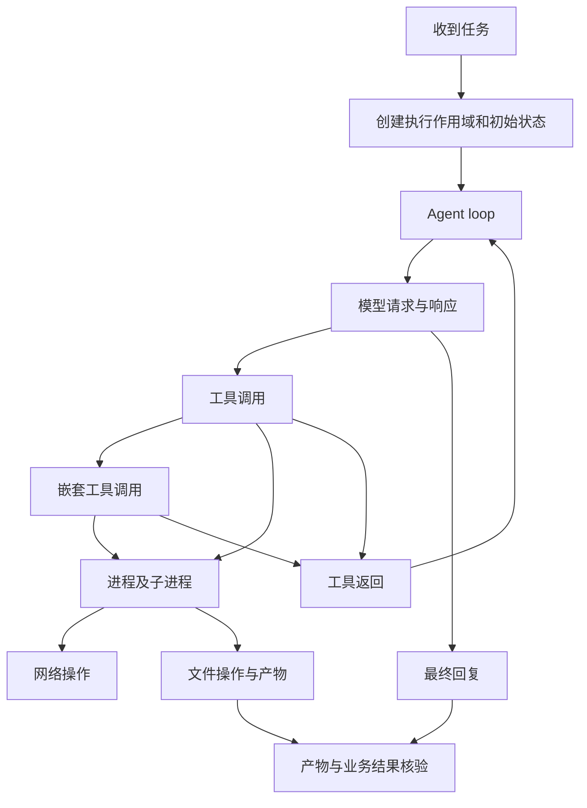
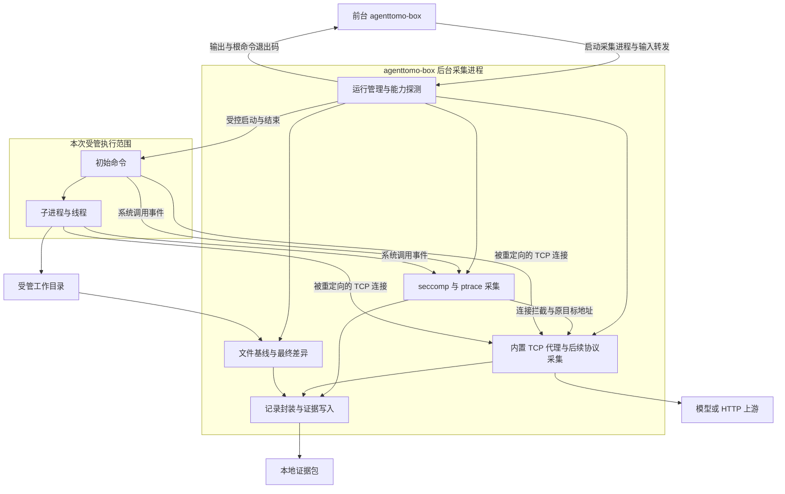
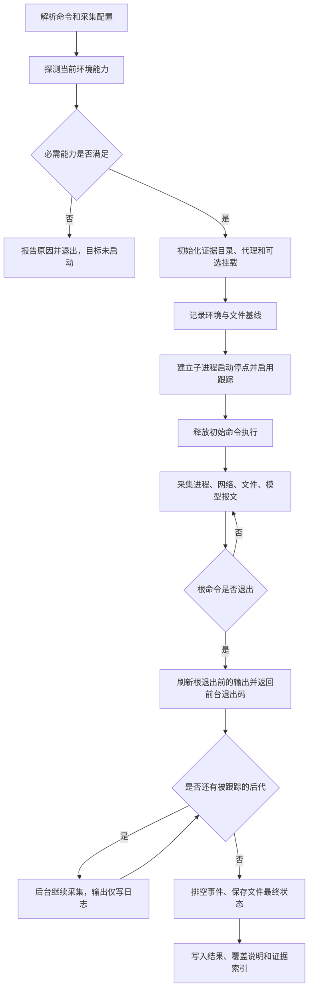
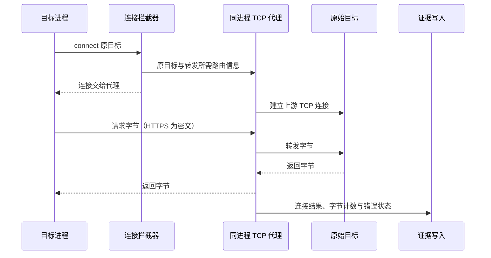

# AgentTomo 一期设计：通用执行与行为采集环境

状态：设计稿；已实现启动器、进程生命周期跟踪、汇总标准流、文件打开路径、TCP 拦截/内置转发代理及 Docker Web Playground。文件完整 I/O、模型明文报文等仍未实现；当前边界见[文件与 TCP 采集](file-network-collection.md)。更新日期：2026-11-05。

一期通过 `agenttomo-box run -c 'xxx'` 启动任意受支持的 Linux 命令，跟踪它及其子进程，采集网络行为、进程执行、文件 I/O，以及经过采集入口的大模型请求和响应，形成可回看的执行记录。

**一期只建设通用执行环境和数据采集，不绑定具体 Agent，不读取或解析其私有会话文件。Trace 关联后续单独设计，不属于本文的实现和验收范围。** Agent 可以作为普通程序运行在环境中。

## 1. 目标与范围

### 1.1 远期目标

对 Agent 应用开展诊断，发现安全、任务执行和运维方面的隐患，为构建、验证和改进 Agent 提供证据。最终能够结合任务意图、模型交互、工具执行、资源变化和业务结果，解释问题发生的位置、原因及影响，并支持复测。

一期先建设其中的环境与事实采集能力，不包含完整的样本管理、Agent 接入、风险判断与准入平台。

### 1.2 一期目标

1. 建立一次执行的明确边界：启动命令、工作目录、受控子进程、采集配置、初始文件状态及结束条件。
2. 采集进程、网络、文件和模型交互四类事实，并保留实际结果、失败原因和采集缺口。
3. 保留各采集源直接提供的时间、PID/TID、参数、地址、路径及原始标识，不在一期拼接完整 trace。
4. 输出稳定、可离线读取的证据包，为后续独立设计的 trace 关联、风险判断和故障注入提供原始数据。
5. 在已有普通容器中优先使用现有权限运行；namespace、OverlayFS 可用时增强环境能力，不作为基础监控的前置条件。

这里的“创建环境”是建立一次受管执行及其观测上下文。没有 namespace、OverlayFS 时，目标仍然运行在原容器的文件系统和网络中；监控本身不会阻止它产生真实副作用。

### 1.3 本期不做

- 特定 Agent 的接入、内部文件解析、任务语义理解、Agent loop 识别和工具调用树恢复。
- 跨采集源的 trace 关联、HTTP 请求到 PID 的映射、端到端因果链及产物归因。本期不设计关联算法、关联标识体系或置信度模型。
- 自动风险定级、污染传播、隔离分支、响应门禁、外部业务状态核验和自动评分。
- HTTP 报文修改、故障注入、`execve` mock、文件内容注入及通用文件系统虚拟化。这些能力后续基于已验证的采集链路建设。
- gVisor、Kata、虚拟机部署或第三方框架源码修改。
- 对任意恶意程序提供完整安全沙箱保证，或承诺观测远端工具服务内部的执行。
- 保证任意程序、任意协议、任意 TLS 配置都能取得明文；首期明确支持范围和接入条件。

### 1.4 已确定的约束

| 约束 | 设计含义 |
| --- | --- |
| 可以控制目标程序的启动 | 从首个受控进程开始采集，并跟踪其本地后代，不做全机进程巡检 |
| 部署在已有普通容器内，可能不能修改容器或节点配置 | 启动时实际探测能力；不以 root、`--privileged`、关闭 AppArmor 为使用前提 |
| 不依赖 eBPF 权限 | 一期使用 seccomp 与对子进程的 ptrace；不加载 eBPF 程序 |
| 不通过遍历所有 socket FD 找进程 | 在系统调用发生时记录调用线程、FD 和地址参数 |
| 不修改第三方框架 | 仅使用标准进程启动、网络协议和目标程序公开支持的端点配置 |
| 中转和代理集成在 AgentTomo 内 | 长驻管理、采集、转发和存储逻辑位于同一个 Rust 进程，不启动独立代理服务 |
| namespace、OverlayFS 是可选项 | 缺失时仍可监控；需要写隔离的任务必须在能力不足时拒绝启动 |

## 2. 产品价值

| 使用者 | 一期能够提供的价值 | 示例 |
| --- | --- | --- |
| 应用和 Agent 开发者 | 获得独立于应用日志的执行事实，检查具体操作是否发生及结果 | 是否执行了子命令、connect 返回了什么错误、配置文件是否打开成功 |
| 安全与运维诊断人员 | 集中保存同一次运行的外部访问、进程启动、文件变化和模型交互记录 | 查看 exec 的参数、文件操作及模型报文，保留各自的时间与来源 |
| 后续评估与分析模块 | 获取带来源、结果和完整性说明的证据，避免仅依据应用自述判断 | 区分“模型声称写入成功”“系统调用写入成功”和“最终文件确实改变” |
| 框架集成者 | 复用通用采集环境，不为每种 Agent 重做进程、网络和文件监控 | 先运行 shell、脚本或二进制，再按需接入 Agent 语义 |

一期的交付价值是“事实可见、来源可查、缺口明确”。风险判断仍需要任务约束、业务授权和外部状态等额外信息。

## 3. 完整行为链的定义

### 3.1 远期完整行为链

完整行为链描述从接收任务，到多轮模型交互、工具调用、嵌套工具调用、进程执行与资源操作，直至返回结果和验证产物的全过程。它需要表达并行、重试与分支；具体 trace 关联方案后续单独设计。



图中的任务、loop、工具和业务结果属于后续语义层；一期只建设运行环境、进程和资源事件，以及可观测的模型报文。即使模型响应中出现 `tool_call`，也只能说明模型返回了这段数据，不能据此证明该工具已经执行。

### 3.2 一期只交付原始采集材料

一期的起点是用户提供的启动命令，终点是该次受管执行结束。所有数据归档到本次 `run_id` 下，各采集源分别保存自身能够直接获得的信息：

| 采集源 | 直接保存的信息 |
| --- | --- |
| 系统调用与进程事件 | 时间、调用 PID/TID、内核提供的创建/退出信息、参数、返回值和错误码 |
| 内置代理 | 代理本地的请求编号、请求/响应、连接对端信息、流式分片和观察时间 |
| 文件状态采集 | 声明目录的初始状态、最终状态、净变化和采集错误 |
| 运行管理 | 启动命令、配置、能力探测、目标退出状态和采集完整度 |

不把代理中的请求自动映射到系统调用中的 PID，不从相邻时间戳推断因果关系，也不在本期建立跨源实体图。单次 syscall 的入口/出口配对、HTTP 请求/响应配对属于完成该条记录所需的采集处理，不扩展为端到端 trace 关联。

### 3.3 远期问题与一期材料

下面保留完整行为链应回答的问题，用来说明采集价值；需要关联、语义理解或判断的问题留到后续单独设计。

| 远期要回答的问题 | 一期保留的材料与范围 |
| --- | --- |
| 这个产物由什么操作生成？ | 分别保存文件操作和文件变化，不做产物归因 |
| 执行作用域从哪个初始状态开始？ | 保存命令、工作目录、环境摘要和受管文件基线；不采集外部数据库完整状态 |
| 哪次工具调用启动了进程？哪个子进程产生事件？ | 保存进程创建和 exec 事件及事件自身的 PID/TID；不识别工具调用 |
| 工具、进程、遥测、风险和响应怎样按时间展开？ | 保存各采集源的时间与原始记录；不组装统一 trace |
| 哪个进程改变文件？相对初始状态如何变化？ | 文件 syscall 保留直接调用者；文件净变化单独计算，不将二者拼成归因结论 |
| 哪些行为偏离任务或 Agent 基线？ | 保存执行事实；本期不建立任务或 Agent 行为基线 |
| 哪些外部操作被尝试、经门禁处理或拒绝？ | 保存尝试、错误码和可见 HTTP 响应；`EPERM` 或 HTTP 403 不自动等于门禁事件 |
| 哪条分支被污染或隔离？为何阻止继续使用？ | 保留原始输入输出和操作；本期不识别污染、隔离分支或响应门禁 |
| 风险和响应分别有哪些证据？ | 记录可以被后续引用，但本期不生成风险或响应结论 |
| 哪些信号交给外部评估器评分？ | 提供结构化事件、报文、文件差异和采集覆盖说明；评分接口后续设计 |
| 能否之后回看和审计？ | 本地证据包支持离线读取和来源检查；不承诺确定性重放或对同权限目标防篡改 |

## 4. 采集内容

### 4.1 网络行为

采集连接尝试、协议族、目标地址和端口、调用 PID/TID、调用结果，以及受支持发送/接收路径的实际字节数。覆盖常规 TCP socket 和 UDP socket 的基础行为；对于代理内的 HTTP 流量，额外记录请求、响应、状态码、首字节时间及结束状态。

为什么采集：网络是模型调用、工具访问和外部副作用的主要出口。系统事件保存谁执行了网络 syscall；代理事件保存请求和响应本身，分别提供连接错误、上层拒绝和请求中断的原始记录。

必须区分：

- syscall 事件中的 PID/TID 来自直接观测；代理请求中的发送进程不在本期推断，两类数据独立保存。
- 非阻塞 `connect` 返回 `EINPROGRESS` 是连接进行中，不能记为成功或最终失败；后续可见的 `getsockopt/SO_ERROR` 和 I/O 结果分别记录，不在一期重建整条连接时间线。
- 对未进入代理的 TLS 连接，一期只能采到连接及密文字节传输等元数据，不能将其标为 HTTP 明文已采集。
- TCP 字节流记录不等于原始 IP 包抓取。本期不交付通用 pcap，不依赖 raw socket、iptables 或 eBPF。
- 单独记录连接耗时、代理观察到的请求耗时和目标侧 syscall 时长；它们不是同一种延迟。

### 4.2 进程执行与 `execve`

记录进程创建、线程创建、`execve` / `execveat` 尝试和结果、退出、退出码及信号。执行事件包含可执行文件路径、参数、工作目录、进程名和按采集策略允许保存的环境变量。

为什么采集：模型或脚本经常通过 shell 和子进程完成操作。只记录顶层命令会丢失真正产生网络和文件行为的执行者。

参数和环境在 exec 入口尽早读取，并区分读取失败、截断和脱敏。成功与失败 exec 分别记录实际结果。`comm`、可执行路径和 `argv[0]` 分开保存，不把进程名当作唯一身份。环境记录是执行时快照，不宣称覆盖之后所有进程内环境修改。

### 4.3 文件 I/O

采集打开、关闭、读写、截断、创建、重命名、删除及相关 FD 操作，记录原始路径、`dirfd`/cwd 上下文、打开标志、实际结果、字节数和执行进程。对已声明的工作目录建立初始与最终文件清单，输出新增、修改、删除、未变或未知状态。

为什么采集：文件既可能是输入和配置，也可能是工具产物或副作用。操作事件回答“执行过什么”，前后差异回答“最终留下什么”，两者不能互相替代。

普通文件 I/O 默认采元数据和字节数，不复制每次 `read`/`write` 的全部缓冲区。需要保留的文件内容按明确的目录、大小和保留策略保存。**这与读取 Agent 私有会话文件来恢复内部流程是两件事；一期不做后者。**

`mmap(MAP_SHARED)` 后的内存写入不逐次触发 `write`。一期记录映射信息并通过最终状态识别净变化；若存在多个潜在写入者，不能保证精确定位每一次修改的进程。`MAP_PRIVATE` 修改也不能直接记为持久文件写入。

### 4.4 大模型完整请求与响应

在请求经过内置代理、协议受支持且未超出采集上限时，保存应用实际发送的请求体和收到的响应体，包括流式分片。主要内容包括提示词、上下文、消息、工具定义、模型参数、可见的工具调用、返回结果、用量及请求错误；字段不存在时不推测补齐。

为什么采集：模型报文能够解释程序向模型提供了哪些信息、模型实际返回了什么，并为后续分析重试、上下文变化和工具意图提供依据。

“完整”限定在**经过观测入口的应用层报文**：不等于提供方内部上下文、隐藏推理、远程文件内容或由历史响应 ID 引用的全部历史数据。保存截断、脱敏、解码失败或流式中断的状态；存在缺失时不能标为完整。

一期以通用 HTTP/JSON 和 HTTP 流式响应为对象，按配置的端点识别模型流量，不依赖具体 Agent，也不要求识别所有模型厂商的字段。通用层保存报文；少量归一化字段提取失败不应导致原始报文丢失。

### 4.5 执行上下文

四类事件还需要一份运行清单：启动命令、cwd、操作系统/内核与架构、采集器版本、启用能力、配置摘要、文件基线范围、实际开始和结束时间、退出状态、丢失计数与不支持的路径。它用于解释证据的适用范围，不扩展为自动收集所有软件配置或用户目录。

## 5. 技术选型

### 5.1 采用 seccomp + ptrace，namespace + OverlayFS 可选

| 机制 | 一期职责 | 条件与边界 |
| --- | --- | --- |
| seccomp filter | 对关心的 syscall 选择性触发采集，减少无关 syscall 的用户态停顿 | 采用 `SECCOMP_RET_TRACE` 配合 ptrace；安装自己的过滤器不能放宽外层过滤器 |
| ptrace | 跟踪自启动子进程、读取 syscall 参数与真实返回值，取得 exec 和退出事件 | 仍受外层 seccomp、LSM、dumpable 等限制，必须实测 |
| 同进程 HTTP 代理 | 获取可解析的请求/响应、流式内容与请求级时序 | 流量必须实际经过代理；TLS 明文需要明确接入方式 |
| user / mount namespace | 在允许时建立受控挂载视图 | namespace 内的能力不等于宿主机权限，也不能绕过外层禁止 |
| OverlayFS | 在声明的工作目录上提供可选 CoW，并辅助产物归档 | 依赖实际挂载能力和底层文件系统支持；不是 syscall 事件采集器 |
| PID / network namespace | 后续按实际收益启用的隔离增强 | 本期基础采集不依赖；不能只创建 netns 却没有可用出网链路 |

seccomp 的过滤器使用 BPF 指令形式，但这条方案不依赖 eBPF 的 `BPF_PROG_LOAD` 权限。无特权安装过滤器采用 `no_new_privs`；它也会限制目标通过 exec 获得额外权限，需要在运行清单中说明。[Linux seccomp 文档](https://docs.kernel.org/userspace-api/seccomp_filter.html)

主路径在选定 syscall 的 seccomp 停点读取入口参数，再取得对应退出结果；用进程跟踪事件处理 fork、clone、exec 和退出。只有入口事件时只能记录“尝试”，不能当作已经完成。停点配对、信号和 syscall restart 必须由每线程状态机处理。[ptrace 接口说明](https://man7.org/linux/man-pages/man2/ptrace.2.html)

`SECCOMP_RET_USER_NOTIF` 不作为一期主采集后端：它可以通知入口和返回代理结果，但 `CONTINUE` 不会自动提供真实执行结果；需要操作目标 FD 的方案还可能被 `pidfd_getfd` 权限卡住。后续确有代理执行需求时再评估，避免同时维护两套 syscall 控制后端。[seccomp 用户通知说明](https://man7.org/linux/man-pages/man2/seccomp_unotify.2.html)

若选择性 seccomp 路径不可用而 ptrace 可用，可以提供纯 `PTRACE_SYSCALL` 兼容模式，但它会产生更多停顿。不能因为用户态只处理几个 syscall，就宣称其余 syscall 没有跟踪开销。外层规则或目标新安装的过滤器也可能覆盖 `RET_TRACE`；发现覆盖缺口时使用经验证的兼容模式，或将本次采集标为不完整。

### 5.2 不采用 eBPF 作为一期依赖

eBPF 适合低开销系统观测，但当前部署约束无法保证程序加载和挂载权限。前期测试中 BPF socket filter、kprobe 加载均被拒绝。已有“eBPF 采集连接与 PID，再通过 map 查询”的方案可以保留为以后具有节点权限时的后端，不作为普通容器的启动条件。

选用 ptrace 的代价是停顿、上下文切换及高频 I/O 下的额外开销。因此一期定位为受控诊断运行，性能结论必须来自工作负载测量，不预设与 eBPF 相同。

### 5.3 其他方案的定位

`LD_PRELOAD` 不能覆盖所有静态程序和直接 syscall 路径，不作为采集基础。gVisor 提供不同的系统调用实现与隔离方式，引入后会改变运行环境和部署要求，当前四类采集不需要先依赖它。namespace、OverlayFS 不可用时也不自行实现一套 ptrace 文件系统；一期直接观测原有文件系统，并明确实际写入的影响范围。

## 6. 整体架构与执行流程

### 6.1 前台入口与采集进程



以上是职责划分，不要求为每个框都建立独立 crate。先在现有 `agenttomo-box` 中形成清晰模块，出现实际复用需求后再拆分。系统采集、代理和文件状态采集分别写出记录，架构中不设置 trace 关联模块。

前台与后台采集器使用同一个二进制。前台只持有调用方的标准流与控制通道；ptrace、日志以及后续代理都归长期存活的采集器所有。代理与 tracer 在同一个 Rust 采集进程内，不另起代理服务。前台退出不能中断仍存活后代的跟踪或代理连接。

ptrace 的等待、停点处理和恢复由专门的管理线程负责；HTTP 转发和证据写入不在该线程中执行阻塞操作。目标停顿期间只做必要的参数快照和状态更新，尽快恢复执行。代理使用成熟 HTTP/TLS 库处理协议与流式传输，不自行实现密码学或 TCP 协议栈；具体依赖在对应实现里程碑内评估兼容性、维护状况和许可证。

采集器与代理自己的进程不属于目标进程树，其出网和证据写入不重复记录为目标行为。证据目录放在文件基线范围之外，避免自我采集。

### 6.2 生命周期



关键约束：目标第一次 exec 之前，跟踪和证据存储已经准备好；文件基线也必须在目标运行前建立。安装过滤器、初始化可选环境和释放启动屏障的顺序需要在最小原型中验证，避免出现目标已经运行而采集尚未接管的空窗。

目标根进程退出不等于所有后代退出。前台以根进程最终 `waitpid` 状态返回，后台继续跟踪后代，不因为根退出而默认终止它们。通过内核 fork/vfork/clone/exec/exit 事件维护跟踪状态，并作为 subreaper 回收孤儿；PPID 改变和 `setsid` 不解除 ptrace 关系。主线程结束、`PTRACE_EVENT_EXIT` 都不能代替整个根进程的最终退出状态。

标准流也必须归后台采集器持有：根退出时只排空该边界已排队的输出，经同一有序 IPC 通道先发送输出、再发送退出通知，不等待后代持有的管道 EOF。此后关闭目标输入的写端，后代的后续输出只落盘。证据包分别保存根退出码和采集状态；前台已返回后的采集错误只能体现在证据包中。

前台异常退出、采集器故障与正常根退出分开处理。当前实现通过父进程退出通知发现前台丢失，并使用 `PTRACE_O_EXITKILL` 避免采集器异常结束后目标继续脱离采集运行；正常返回前台前先解除父退出通知。外层容器或任务 cgroup 整体结束仍会终止采集器，不能靠这层进程拆分绕过。长期后代会延长后台资源占用，当前没有默认后台超时。

### 6.3 启动方式

核心启动接口：

```bash
agenttomo-box run -c 'xxx'
```

例如，一期验收可以运行通用测试脚本，无需 Agent：

```bash
agenttomo-box run -c 'sh ./test-workload.sh'
```

当前 `run` 已支持 `-c`、标准流、进程创建/成功 exec/退出、文件打开路径及 TCP 拦截代理，并保留前台先退出、后台继续服务后代的生命周期；使用方式见 [agenttomo-box 说明](../crates/agenttomo-box/README.md)。输出仍是管道汇总，尚未实现逐 exec 输出归属、文件完整 I/O 和模型明文采集。

`agenttomo-box playground` 提供 Docker 交互终端和实时进程 trace，复用同一个采集 worker，使用 PTY 传输输入和合并输出。Web/Docker 会话管理与底层采集分开，详见 [Playground 设计](playground-design.md)。

`-c` 采用 `/bin/sh -c` 命令语义；当前通过 `--output-dir` 指定日志目录，目标 stdin/stdout/stderr 使用普通管道。后续采集配置再扩展启动目录、文件基线范围、模型上游路由、采集上限、环境变量保存规则和必需能力，不在最小启动器中提前实现。

当前网络切片已经拦截支持的 TCP 连接，转交内置代理连接原目标；无需目标设置代理环境变量。代理会改变本地 connect 的错误时机和可见 peer，具体边界见独立设计。模型明文采集是后续协议层能力，可能还需要目标信任证书或配置公开模型端点。

## 7. 网络与模型采集链路

### 7.1 分层采集

网络采集分为两层：

1. 系统层拦截支持范围内的目标 TCP 连接，保存原目标地址，并将连接交给 box 采集进程内置代理转发。首个网络切片验证双向字节流，HTTPS 保持密文，不引入 iptables。
2. 应用层在后续切片解析进入代理且能取得明文的 HTTP/模型请求。TCP 转发成功不代表已获得 HTTPS 请求和响应内容。

后续模型明文采集可以考虑“可配置本地端点 + 反向代理”：目标到代理的本地 HTTP 请求可被读取，上游 TLS 由代理正常建立和校验，无需修改 Agent 框架。若程序只接受固定 HTTPS 端点或不允许配置路由，则这条路径不可用，不能承诺完整报文采集。

普通 HTTPS 正向代理的 `CONNECT` 通道仍然是 TLS 密文。通用 HTTPS 透明解密需要额外的证书信任、协议兼容性和证书固定处理，不列入当前网络切片。仅覆盖目标树中明确支持的 TCP 建连方式，不承诺全机或任意 socket 行为都可无差别重定向。

### 7.2 同进程代理流程

拦截器需要把原目标地址与代理接收到的连接可靠对应，随后代理连接原目标，双向转发字节。该路由状态只解决转发所需的连接配对，不能只把 `connect` 地址改成一个普通 HTTP 代理端口。具体适配在网络实现步骤单独验证非阻塞连接、失败、半关闭和并发行为。



代理可为一次 HTTP 交互生成本地 `request_id`，用于保存对应请求、响应及流式分片。它只在代理记录内有效，不用作跨采集源 trace ID。系统采集器独立记录同次运行中的 syscall 事件，二者之间的关联方案留到后续。

### 7.3 报文与流式处理

请求和响应边转发边写证据，不等完整响应结束后再发送给目标。记录原始应用层 body、相关 headers、流式分片顺序与观察时间；若解压或解析，保留处理方式及原数据引用。这里不承诺保存底层 TLS record 或逐字节完全一致的 HTTP 传输编码。

代理不自行重试模型调用，避免增加用户未请求的实际请求。目标自身重试形成独立请求记录，本期不识别重试组。连接中断时保存已经接收的分片，区分上游失败、目标取消和采集器故障；不将未结束的流当作完整响应。

首期验收 HTTP/1.1 与 SSE，并覆盖同一连接的多次请求。HTTP/2、WebSocket、HTTP/3、QUIC 不计入默认完整报文覆盖范围，避免将协议接通与内容完整采集混为一谈。

模型请求 body 可能包含敏感内容。认证头、Cookie 等默认不落盘；需要脱敏或限制保存的 body 字段按配置处理，并记录脱敏范围。完整 body 归档与脱敏摘要是不同采集状态，不能把摘要标成原始完整请求。

## 8. 文件状态与采集上下文

### 8.1 直接采集的进程与 FD 信息

采集器维护跟踪、等待和恢复执行所必需的进程/线程状态。进程事件保存内核提供的创建者和新建 PID/TID；syscall 记录调用者、原始 FD、参数和返回值。`dup*`、`fcntl` 复制、`close_range` 等操作保留为原始事件，不在本期构建跨进程 FD 关系图。

PID 和 FD 都可能复用，所以日志必须保留时间、来源和原始操作，不能在展示时把相同数字自动合并为同一个全局对象。可直接读取的进程启动时间等上下文随记录保存；读取失败时注明原因，未来关联设计再决定如何使用这些材料。

文件路径保留原始参数和解析证据。相对路径、`openat` 的目录 FD、符号链接、重命名及已删除但仍打开的文件都不能只用字符串拼接还原。读取已知目标 FD 的信息属于定点补充，不等于遍历全机 FD。

### 8.2 文件基线与净变化

文件变化统计只针对配置中明确声明的根目录。初始清单记录相对路径、类型、大小、必要元数据和内容 hash；需要后续展示原内容时另外保存允许归档的原始文件。读取失败、大小限制和排除规则单独记录，不能凭最终扫描补造初始内容。

| 初始与最终状态 | 净变化分类 |
| --- | --- |
| 初始不存在，最终存在 | 新增 |
| 初始存在，最终不存在 | 删除 |
| 前后存在，内容或纳入比较的元数据不同 | 修改 |
| 前后存在，纳入比较的状态相同 | 未变 |
| 初始或最终状态未成功采集，或存在无法排除的竞争修改 | 未知 |

“未变”只表示最终净状态一致。先写入再恢复、创建后再删除，都仍应出现在操作事件中。重命名保留独立操作证据，路径清单可能同时表现为旧路径删除和新路径新增。

初始扫描需要工作目录保持静止；普通逐文件扫描不是原子快照。检测到扫描期间变化或已知外部写入时标记基线不稳定。对 `mmap`、未支持的异步 I/O 或外部进程写入，最终 diff 可以证明变化存在，却不一定能够证明写入者。

### 8.3 OverlayFS 增强

可用时，为选定工作目录建立 lower、upper、work 和 merged：目标访问 merged，修改和新增进入 upper，删除通过 upper 中的删除标记体现。upper 和 work 的文件系统条件、删除标记及目录行为需要按内核要求处理，不能只把 upper 中普通文件的列表当作全部差异。[OverlayFS 文档](https://docs.kernel.org/filesystems/overlayfs.html)

初始基线仍单独保存，最终差异按目标看到的合并视图解释。OverlayFS 本身不记录“哪个进程做了修改”；一期只保存差异，不做产物归因。lower 被外部进程修改也不会自动变成冻结快照。

只承诺通过受管 merged 路径进行的受支持文件操作不会直接改写对应 lower。挂载前继承的 FD、其他路径别名、受管目录之外的文件以及外部数据库都需要单独考虑，不能宣称整个真实系统不受影响。OverlayFS 未启用时，目标文件写入会直接作用于当前环境。

## 9. 事件与证据格式

### 9.1 最小数据约定

统一记录包含 `schema_version`、`run_id`、`event_id`、事件类型、采集来源、观察时间、操作内容、结果及采集状态。各来源保留自己直接获得的字段，不强行对齐进程、连接和模型请求实体。需要等待完成的 syscall 可以使用源内 `operation_id` 保存入口和退出，运行中断时也能保留已经发生的尝试。

时间同时保存单调时钟和墙上时间：前者用于本机耗时和排序，后者用于展示和与外部日志对照。保存采集源序号及写入序号；不同线程上的观察先后不自动等于业务因果先后。

下面是直接 TCP 建连完成事件的示意，不是已实现的固定协议：

```json
{
  "schema_version": 1,
  "run_id": "run-example",
  "event_id": "event-42",
  "operation_id": "operation-17",
  "kind": "network.connect.completed",
  "source": "ptrace",
  "time": {
    "wall": "2026-11-04T10:00:00+08:00",
    "monotonic_ns": "1234567890"
  },
  "process": {
    "pid": 1204,
    "tid": 1204
  },
  "operation": {
    "fd": 6,
    "family": "AF_INET",
    "destination": "127.0.0.1:8000"
  },
  "result": { "return_value": 0, "errno": null },
  "capture": { "status": "complete", "limitations": [] }
}
```

示例中的 PID/TID 是直接 syscall 观测值。代理生成的请求记录没有目标 PID 时不填写该字段；本期不为此反查进程。`complete` 仅说明该条记录采集完整，不表示整个运行或全部网络流量完整。

大报文和文件内容通过 `body_ref` / `artifact_ref` 引用单独保存的 blob，事件中不重复嵌入。未来的风险判定、决策和动作作为独立记录引用这些事件，不修改原始事实来匹配判定。

### 9.2 本地证据包

```text
<run-directory>/
  manifest.json          # 配置摘要、版本、能力、运行和采集状态
  events.jsonl           # 进程、网络、文件、模型及采集异常事件
  blobs/                 # 允许保存的报文和文件内容，按内容标识引用
  files/
    baseline.jsonl       # 初始文件清单及快照引用
    final.jsonl          # 最终文件清单
    changes.jsonl        # 文件净变化，不包含操作归因
  summary.json           # 计数、耗时、退出结果、缺口和证据索引
```

一期使用追加写入的 JSONL 和普通文件，无需引入数据库、消息队列或图数据库。分析器可离线读取证据包；后续需要检索性能时再建立可重建的索引。

运行开始时先写未完成状态，结束时再原子更新最终清单。异常退出后的半条尾部记录按明确规则识别，不能把损坏的尾部当成运行正常结束。hash 用于引用和校验保存内容，不表示对同权限目标具备防篡改能力。

### 9.3 完整性与数据保存

完整性按类别记录，例如进程采集状态、文件基线覆盖、网络协议覆盖、模型报文完整度。原因至少区分 `permission_denied`、`unsupported`、`unreadable`、`truncated`、`redacted`、`lost` 和 `interrupted`，不能统一显示为“未发现事件”。

参数、环境变量、URL、headers、模型 body 和文件内容都可能带敏感数据。默认不归档认证材料；环境变量值采用允许名单，其他内容按本次运行的保存规则处理。证据目录限制访问权限，保存规则及实际截断、脱敏情况写入清单。同 UID 目标仍可能访问管理进程或证据，不能把本地权限设置宣传为完整凭据隔离。

## 10. 可靠性、性能与支持边界

### 10.1 故障处理

- 初始化失败发生在目标执行前，报告失败步骤和原因。
- 必需事件使用有界队列，磁盘写入与目标恢复解耦。队列耗尽或存储失败时明确使采集失败，并停止本次受管执行，不能静默丢失关键事件后报告成功。
- body 大小、文件大小和保存总量有配置上限。达到内容上限可以保留元数据并标记截断；如果任务要求完整内容，则本次采集要求没有满足。
- 管理进程退出时，已经建立跟踪关系的目标采用退出联动清理；启动阶段失败也要回收已创建子进程。异常情况下不能保证最终清单成功写入，未完成清单本身必须可识别。
- 正常完成时透传目标退出状态；采集器自身失败返回非零，并尽可能另存目标实际状态。目标执行成功与采集完整度是两个独立结论。

### 10.2 首期支持边界

| 维度 | 首期验收范围 | 不作完整承诺的情况 |
| --- | --- | --- |
| 系统 | 优先验证现有 Linux x86-64 环境，按原语探测 | 其他架构、兼容 ABI 和未验证内核需要独立支持 |
| 进程 | 自启动的普通用户程序及受控后代 | 提权执行、被其他 tracer 占用、失去跟踪权限、远程执行 |
| 文件 | 常规同步文件 I/O 与 FD 操作事件、受管目录前后差异 | 每次 mmap 内存写、未支持的异步 I/O、目录外完整状态 |
| 网络 | 常规 TCP/UDP socket 元数据；逐项列明已实现 syscall | 原始包完整捕获、内核内部流量、未支持的 io_uring 网络路径 |
| HTTP / 模型 | 通过内置代理的 HTTP/1.1、JSON 和 SSE | 未经过代理的 TLS 明文、HTTP/2、WebSocket、HTTP/3、QUIC |
| 原始上下文 | 采集源直接获得的 PID/TID、时间、参数及协议字段 | 跨源 trace 关联、请求到 PID 映射、Agent loop 和工具语义 |
| 隔离 | 已实际启用并验证的受管目录增强 | 默认全机写保护、强多租户隔离、外部业务副作用回滚 |

实现必须发布所支持的 syscall 清单，包括需要的 `*at`、向量 I/O 及 FD 复制变体。单个常用命令测试通过不代表文件或网络类别已经全覆盖。对于 `io_uring`、外部 FD 传入等路径，支持不足时输出限制；本期不通过禁止应用行为来伪造完整观测。

### 10.3 性能验证

建立同一固定工作负载的直接运行与受管运行对照，分别测量纯 ptrace 模式、seccomp 选择性模式及代理开启后的变化。至少覆盖进程创建密集、文件 I/O 密集、多连接并发、大响应和长时间流式返回。

报告总耗时、CPU、峰值内存、事件速率、队列峰值、证据体积、丢失计数及请求延迟分布。完整性先于吞吐量：通过测试计数与真实结果核对事件，不允许通过无声采样得到漂亮的性能数据。

目前没有完整实现的测量结果，不预先承诺固定开销百分比或并发量。先完成最小切片测量，再确定适合诊断任务的默认上限。
