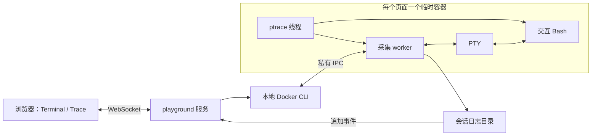

# AgentTomo Playground

## 目标与范围

提供两个公开子命令：`agenttomo-box run -c '…'` 保留当前受管执行语义；`agenttomo-box playground` 启动 Web 服务。网页左侧是 Docker 容器中的真实终端，右侧实时展示该会话的进程 trace。

当前 trace 范围是 fork/vfork/clone、成功 exec、退出、文件打开和 TCP 重定向/转发。HTTPS 保持密文；不读取 Agent 私有会话文件，不增加 Agent 语义 trace 关联。文件和网络支持边界见[文件与 TCP 采集](file-network-collection.md)。

## 架构判断与方案

现有前台、采集 worker、专用 ptrace 线程的分工合理：前台寿命和目标后代寿命分离，ptrace 操作固定在同一个 OS 线程，落盘与异步 I/O 由 worker 负责。需要补足的是交互终端传输，而不是重写采集器。

本次选择 Axum WebSocket + 本地打包的 xterm.js；Docker 使用现有 CLI。独立 WebTTY 服务会引入第二套会话和 trace 通道管理；把 Docker/Web 代码塞进 tracer 会混淆职责。直接采用平台 PTY（通过 nix）补足 worker 的终端模式，复用原采集链路。

## 模块边界

- `cli/`：Clap 子命令与参数；`main.rs` 仅分派入口和管理 runtime。
- `execution/`：前台、采集 worker、启动屏障和私有 IPC。
- `tracing/`：原生进程事件、ptrace 停点与恢复、exec 元数据。
- `syscall/`：选择性 seccomp 过滤、目标内存和寄存器机制。
- `collectors/file/`、`collectors/network/`：分别解释文件与网络 syscall，互不引用。
- `proxy/`：同一 worker 内的 Tokio TCP 转发，不依赖 ptrace 或文件采集。
- `terminal/`：PTY 分配、异步读写与窗口尺寸；不包含 Docker 或 Web 逻辑。
- `recording/`：原始输出和 JSONL 证据、根退出与采集完成状态。
- `playground/`：HTTP/WS、Docker 容器会话、日志追加读取、静态页面。

依赖方向是 playground 通过 worker 的 IPC 与证据文件使用采集能力；execution 启动 tracing 与 proxy，并管理 terminal、recording。底层模块不依赖 playground；tracing 分发 syscall 给各采集模块，network 仅将路由上下文交给代理。

## 会话与终端

默认每个页面建立一个独立临时容器，页面断开或服务正常停止时删除该容器，日志保留。Docker 先 create，再 attach/start，以便连接失败时也能准确清理自己的容器。仅删除当前会话创建的容器，不执行全局 prune。

使用本地已有 `ubuntu:24.04`，可由 `--image` 指定其他兼容镜像，不自动拉取。只挂载只读的 box 二进制和该会话日志目录；不挂载项目、宿主根目录或 Docker socket 到目标容器。目标以当前用户 UID/GID 运行，不加特权，保留 Docker 默认 seccomp，清空 capabilities。

终端使用独立 PTY，支持输入、ANSI 显示、Ctrl-C、窗口 resize 和 Bash 作业控制。PTY 的 stdout/stderr 天然合并，保存到 stdout.log，不能再声称两个流可以分开。普通 `run` 继续使用原来的独立管道。

根进程退出与采集完成仍分开处理：根退出禁用终端输入，存活后代继续采集；worker 结束才标记会话采集完成。关闭页面属于用户结束临时 playground，会清理整个容器。

## Web 与证据

默认地址为 `127.0.0.1:8080`，支持 `--listen`。启动时生成随机访问令牌并打印完整 URL；页面和 WS 均校验令牌，浏览器 WS 同时校验 Origin。静态资源在二进制内，不依赖 CDN 或生产环境 Node.js。

终端输出使用二进制 WS 帧，状态和 trace 使用 JSON；输入和 resize 转换为现有 worker IPC。右侧按下述进程树规则组织真实事件，原始日志继续落盘。

### 进程树与节点行为

右侧采用可折叠的任务树：节点展示命令、TID 和运行/退出状态；展开后展示该节点的行为时间线及子节点；点击行为查看原始事件。默认展开根节点和新分支，实时追加不能重置用户的折叠状态。

仅按原生创建事件建立父子边：fork/vfork/clone 创建子节点；成功 exec 是同一任务更换程序，在节点内显示 `a → exec → b` 并保留之前的历史，不能把 exec 画成新子进程。当前原始数据使用 TID，不含完整 TGID 信息，因此界面标注 TID，clone 分支明确标为任务，不声称全部都是独立进程。非主线程 exec 导致 TID 改变时使用 `former_tid` 延续执行任务，保留旧 leader 的历史；TID 退出后再次使用时创建新的实例。

界面保留最近 1,000 条行为，保留仍存活的节点及展示历史所必需的祖先；无剩余行为或后代的已结束节点可回收。祖先行为过期会明确显示省略条数。退出只改变节点状态，不立即删除历史。行为缺少 TID 时显示为未归属，不能猜测所属进程。

文件事件展示路径与返回 FD/错误；网络事件区分本地代理连接、上游连接结果和转发字节数。各事件携带运行内 `task_id`，fork 携带 `child_task_id`，晚到的代理事件沿该身份回到原任务，不复活已退出任务或挂到复用 TID 的新任务；缺少稳定 ID 的历史记录继续使用原 TID 规则。若节点历史已回收，晚到事件可以显示为状态未知的独立节点，不猜测新的父子关系。此 ID 只保持已观测任务的身份，不恢复 Agent 工具调用语义。

展示复用 JSONL/WS 协议及原生 `details/summary`，前端事件模型独立于 DOM。平铺表格无法直观看出创建关系，额外服务端树协议会重复已有事件信息，因此保持树投影在前端。

## 验证

保留现有运行生命周期测试，补充子命令、PTY isatty/resize/Ctrl-C、访问控制和会话清理测试。用真实 Docker 和浏览器验证命令执行、右侧 trace、窗口缩放、断线清理、服务退出清理。测试不能以静态示例事件代替实际采集。
