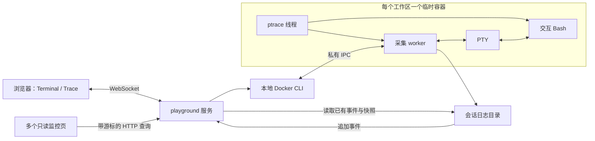
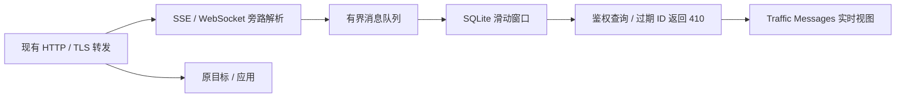

# AgentTomo Playground

## 目标与范围

提供两个公开子命令：`agenttomo-box run -c '…'` 保留当前受管执行语义；`agenttomo-box playground` 启动 Web 服务。网页左侧是 Docker 容器中的真实终端，右侧实时展示该会话的进程 trace。

当前 trace 范围是 fork/vfork/clone、成功 exec、退出、文件打开、mmap 调用、TCP 转发和 UDP 收发/转发。默认 HTTPS 保持密文；开启 `--capture-http` 后，通过 OverlayFS 注入任务 CA，支持 HTTP/1.1 请求/响应内容与 TLS 解密，在 Traffic 页展示真实头信息和限量正文，原事件 JSON 详情保留。不读取 Agent 私有会话文件，不增加 Agent 语义 trace 关联。支持边界见[内容检查设计](content-inspection-design.md)、[文件与 TCP 采集](file-network-collection.md)、[mmap 采集](mmap-collection.md)和[UDP 采集](udp-collection.md)。网络事件只由代理生成；TCP 关联建连者，UDP 保留流参与者，多参与者时不猜单个 PID。

## 架构判断与方案

现有前台、采集 worker、专用 ptrace 线程的分工合理：前台寿命和目标后代寿命分离，ptrace 操作固定在同一个 OS 线程，落盘与异步 I/O 由 worker 负责。需要补足的是交互终端传输，而不是重写采集器。

本次选择 Axum WebSocket + 本地打包的 xterm.js；Docker 使用现有 CLI。独立 WebTTY 服务会引入第二套会话和 trace 通道管理；把 Docker/Web 代码塞进 tracer 会混淆职责。直接采用平台 PTY（通过 nix）补足 worker 的终端模式，复用原采集链路。

## 模块边界

- `cli/`：Clap 子命令与参数；`main.rs` 仅分派入口和管理 runtime。
- `execution/`：前台、采集 worker、启动屏障和私有 IPC。
- `execution/rootfs/`：可选一级目录及 SSL OverlayFS 的选择、元数据和任务临时存储；与文件采集解耦。
- `tracing/`：原生进程事件、ptrace 停点与恢复、exec 元数据。
- `syscall/`：选择性 seccomp 过滤、目标内存和寄存器机制。
- `collectors/file/`、`collectors/memory/`、`collectors/network/`：分别解释文件、内存映射与网络 syscall，互不引用。
- `proxy/tcp/`、`proxy/udp/`：同一 worker 内相互独立的 Tokio 转发，不依赖 ptrace 或文件采集。
- `proxy/outbound`：TCP 出口建连；可选 HTTP CONNECT 隧道，只处理传输，不判断应用协议。
- `terminal/`：PTY 分配、异步读写与窗口尺寸；不包含 Docker 或 Web 逻辑。
- `recording/`：原始输出和 JSONL 证据、根退出与采集完成状态。
- `playground/`：HTTP/WS、Docker 容器会话、日志追加读取、静态页面。

依赖方向是 playground 通过 worker 的 IPC 与证据文件使用采集能力；execution 启动 tracing 与 proxy，并管理 terminal、recording。底层模块不依赖 playground；tracing 分发 syscall 给各采集模块，network 只将私有五元组/进程元数据交给关联表，代理使用内核实际接收的地址查表。namespace 与常驻 socket 的初始化独立放在 `network/`。

## 会话与终端

默认每个工作区主页面建立一个独立临时容器。记录与配置直接写入容器的 `/records` tmpfs，主页面断开、采集完成或服务正常停止时删除容器，随之销毁 tmpfs 和容器可写层。Docker 先 create，再 attach/start，以便连接失败时也能准确清理自己的容器。只删除当前会话创建的容器，不执行全局 prune；单次 Chat 任务结束不结束沙箱。

Docker CLI 子进程使用独立进程组，宿主终端的 Ctrl-C 由 Playground 处理，连续按键不会打断创建、attach 或清理命令；网页终端中的 Ctrl-C 仍通过 PTY 作用于目标前台任务。控制命令保留 30 秒超时。`docker rm` 失败或超时时，再查询该名称的容器：只有查询成功且确认不存在才把清理记为成功；容器仍存在或无法查询时，记录原命令的退出码/信号或 I/O 错误，以及复核结果，不把 Docker 权限/连接错误视为容器已删除。

默认使用本地 `agenttomo-playground-chrome:24.04` 并自动启动 Chrome，镜像包含 Ubuntu 24.04 工具集和桌面组件。构建方法见[镜像说明](../docker/playground-chrome/README.md)。可由 `--image` 指定其他兼容镜像，不自动拉取或构建。宿主机只提供只读的 box 二进制及可选 Codex 程序目录；不提供可写 bind mount，不挂载项目、宿主根目录或 Docker socket。容器使用 `--log-driver=none`，防止终端协议内容被 Docker 日志驱动另存到宿主机。

可通过 `--overlay-root` 开启[一级目录及 SSL OverlayFS](root-overlay-design.md)，所有私有层
共用默认 512 MiB 的容量上限，可配置豁免路径；不增加 Docker capabilities。只覆盖能整目录
挂载的一级目录，以及 `/etc/ssl`；包含子挂载的目录整体跳过。当前 `/usr`、`/etc/ssl` 之外的
`/etc`、带浏览器时的 `/tmp` 保持容器原视图，写入不隔离。浏览器通信使用两个小型 tmpfs；
主命令退出后，存活后代继续使用任务挂载。

容器采集器及终端使用 root（UID/GID 0），终端的 HOME 和初始工作目录为 `/root`。容器从 `cap-drop=ALL` 开始，仅为身份映射和文件检查增加 SETUID、SETGID、SETFCAP、DAC_OVERRIDE，保留 no-new-privileges，不使用 privileged。启动器在独立 user/net namespace 中完成配置，父采集器写入与外层相同的有效 UID/GID 范围，使终端可以切换到普通浏览器用户。目标执行前收回网络、挂载等管理能力，只保留身份切换能力；root 账号仍受这些能力限制，并非无限制的系统管理权限。为允许嵌套 user/net namespace，开发容器设置 seccomp=unconfined、apparmor=unconfined；这放宽了容器策略。网络工具与内核 TPROXY 能力不足时启动失败，不回退旧路径。

Playground 采集器以容器 root 写入记录，目录 0700、文件 0600。原有 `run` 的执行身份和持久化行为不变。

`/records` 默认上限 512 MiB，由 `--session-tmpfs-size-mib` 配置，按使用量分配；记录、Codex 原生会话和控制 socket 共用这一容量。`/records/<session-id>/run/` 保存现有 JSONL、正文和 SQLite；`/records/codex/` 是私有 CODEX_HOME；`/records/control/` 保存容器内部通信 socket。`--overlay-root` 始终豁免 `/records`，避免覆盖通信路径。该挂载保留执行能力，以兼容 Codex 在私有 home 中安装的工具；仍设置 nosuid/nodev。

登录配置经内存快照、Docker attach 标准输入传入，不在宿主机写中转文件、不放在命令参数中，也不复制外层历史会话。宿主 Web 每个沙箱建立一条常驻 `docker exec` 管道，以 Hyper/Axum 的 HTTP/1 协议调用容器内现有读取接口，无新增监听端口、无每次轮询创建进程。所有监控页仍有独立游标，文件/HTTP/模型内容预览和 SSE/WebSocket 查询保持同一 API。连接故障会报告错误，不降级到宿主文件存储。

采集完成时先原子写完成标记，保留容器直到工作区读完最后一批事件再移除，避免 tmpfs 提前卸载而丢失后代尾部事件。单次 Chat 完成、取消仍保留沙箱及续聊状态。容量耗尽会按现有记录写入错误报告并结束沙箱，不回退磁盘；可增大上限。tmpfs 上限不是整个容器内存限制；系统启用 swap 时页面仍可能换出。宿主进程崩溃和 Docker 删除失败仍可能留下活容器，正常清理失败必须明确报告。此方案隔离本地运行数据，不消除共享账号额度、真实联网操作或 CPU/内存消耗。

旧的 Playground `--output-dir` 参数继续接受但不再写入。宿主端只保留活跃连接和必要的内存状态。

`--proxy http://host:port` 为内置代理选择 TCP 出口，缺省为 `http://127.0.0.1:8118`，可用 `--no-proxy` 关闭；收到连接便向上游发送 `CONNECT 原目标IP:端口`，成功后转发任意 TCP 数据。目标程序不接收代理环境变量；HTTP/TLS 采集位于隧道内，原地址和五元组保持不变，box 的内部握手不作为应用事件。上游代理握手失败不直连回退；UDP 保持原路径。Playground 的宿主 loopback 代理由 bridge 上的受限转接访问，配置走内存 bootstrap，不写入 Docker 环境和 Codex 副本。无参数时兼容原宿主代理变量和本地 JSON 配置，优先级及支持范围见 README。普通 `run` 使用同名参数，无 Docker 转接。

终端使用独立 PTY，支持输入、ANSI 显示、Ctrl-C、窗口 resize 和 Bash 作业控制。PTY 的 stdout/stderr 天然合并，保存到 stdout.log，不能再声称两个流可以分开。普通 `run` 继续使用原来的独立管道。

根进程退出与采集完成仍分开处理：根退出禁用终端输入，存活后代继续采集；worker 结束才标记会话采集完成。关闭工作区主页面属于用户结束临时 playground，会清理整个容器。

## Web 与证据

启动时检查所选镜像中的浏览器启动、桌面和 Chrome wrapper 三个可执行脚本。完整安装自动启用浏览器，全部缺省进入终端模式，部分安装或 Docker 探测失败则报告错误。检查在网络禁用、只读的临时容器中执行并清理，后续会话使用同一镜像 ID。`--image` 保留镜像选择能力，旧命令应删除 `--browser`。
浏览器模式下左侧显示 Terminal / Browser 标签页，右侧展示观察视图和原始事件详情。
被跟踪的启动脚本等待图形环境就绪后启动 Chrome，再 exec 为交互 Bash；
Chrome wrapper 使用 setpriv 切换为 nobody（UID/GID 65534，HOME=/tmp），保留 Chrome 自身沙箱及证书校验，不加入 --no-sandbox。Chrome 的网络服务及其他后代复用同一采集链路。Xvfb/Openbox/x11vnc 同样使用 nobody，作为
会话内显示基础设施运行，不放入目标进程树。独立 desktop 模块负责就绪检查、
`/api/sessions/{session}/desktop` WebSocket 的 token/Origin/存活会话校验、
有界转发和取消；仅通过 Docker exec 连接容器 loopback VNC，无额外公开端口。
Chrome wrapper 从既有 OverlayFS 读取任务公开 CA，导入临时容器 NSS 数据库；
宿主信任不变。用户关闭工作区主页面或服务关闭时，显示连接和容器统一清理。

默认地址为 `127.0.0.1:8080`，支持 `--listen`。启动时生成随机访问令牌并打印完整 URL；页面和 WS 均校验令牌，浏览器 WS 同时校验 Origin。静态资源在二进制内，不依赖 CDN 或生产环境 Node.js。

`file.open` 增加独立文件预览面板，原始事件 JSON 详情继续保留。预览从事件关联的已保存内容加载，提供文本/JSON/Hex，使用图标按钮复制当前内容和关闭预览；失败、未采集、空文件与截断有独立状态。`GET /api/sessions/{session}/file-preview` 使用同一个访问令牌，仅接受固定快照文件的 offset/length，限制读取大小并拒绝路径符号链接；不允许任意宿主文件路径。旧记录无内容时不发起路径读取。完整边界见[内容检查设计](content-inspection-design.md)。

终端输出使用二进制 WS 帧，状态和 trace 使用 JSON；输入和 resize 转换为现有 worker IPC。右侧按下述进程树规则组织真实事件，原始日志继续写入沙箱 tmpfs。

终端与 trace 面板使用统一深色主题。trace 视图位于底部时跟随新命令和事件滚动；用户向上查看历史时保持阅读位置，回到底部后恢复跟随。滚动仅作用于 trace 面板，不移动整个页面或展开已折叠分支。

### 同一会话的多个监控页面

右上角只增加两个图标：收起/展开当前页的监控栏，以及在新页面打开同一 session 的监控。打开独立页不改变主页面布局；多个监控页与主页面可以共存，事件筛选、当前标签、选中项和滚动状态各自独立。独立页保留完整的观察界面，不显示终端、浏览器控制、New session 或收起按钮。

`app.js` 根据 `monitor` 查询参数选择入口：`workspace.mjs` 负责原有终端/桌面和拥有容器的 WebSocket；`monitor.mjs` 只跟随事件日志。两者共用 `observation.mjs` 初始化的进程树、Traffic、文件预览与事件详情，不复制观察逻辑。无效或已丢失的 session 显示错误，绝不回退到创建容器。

独立页通过带相同访问令牌的 `GET /api/sessions/{session}/events?offset=<字节游标>` 分批读取 `events.jsonl`。每批目标上限为 256 条或 1 MiB；单条完整记录可超过批次字节上限，但不超过现有 16 MiB 记录限制。活跃时每 250 ms 查询一次，回放未读历史时立即继续，单页不并发轮询。瞬时连接错误从原游标重试，关闭页面取消请求。每页保有自己的游标，不影响其他读者或采集器；前端内存仍采用现有最近事件窗口。

服务维护 session 存活状态与根 PID 的小型登记表，在采集和清理结束后移除。活跃会话仍通过独立游标读取，未写完的一行等待后续查询。游标须位于记录边界；读取复用文件预览的目录访问约束，拒绝路径符号链接及非普通日志文件。完成标记仅短暂保存在容器 tmpfs 中用于排空最终事件，移除容器时元数据与载荷一起消失；清理错误保留在服务错误输出和仍可连接的页面提示中。

这一步保留主页面拥有容器的生命周期：关闭监控页不停止任务，关闭工作区主页面清理容器及记录。记录删除后，独立监控页停止轮询并解释记录已不可用，刷新不再回放。销毁不会等待每个监控页读完末尾；主页面正常完成前仍会排空自己的最后一批事件。已经收到的数据可能仍留在页面内存中。新的 Playground 读取接口仅服务活跃沙箱，不再读取宿主归档；已有手动保留的文件不会被新服务自动删除。SIGKILL、主机故障和清理失败不能保证删除成功；不添加会误删其他服务会话的全局回收逻辑。

### 进程树与节点行为

右侧按进程展示可折叠树：节点只展示命令、PID 和运行/退出状态，不展示线程节点或 TID。同一进程的各线程行为按观察顺序合并；线程创建和单独退出不显示成命令生命周期。所有已知线程退出后才显示该进程结束；由线程创建的真正子进程直接挂到所属进程下。点击行为可在原始事件中查看 PID 与进程生命周期标识。所有命令节点默认收起；运行中新增可见事件短暂闪烁，隐藏子进程的活动也提示在运行中的祖先上。已展开节点继续追加并保留底部跟随；手动向上滚动后保持阅读位置，不重置折叠状态。尊重 reduced-motion。

事件优先显示 `data.started_unix_ns`，文件打开和 mmap 取 syscall 入口时间，TCP/UDP 转发汇总取代理收到连接或首包时间。缺少开始字段时使用 `observed_unix_ns`，新记录在记录器入队前采集该值。时间按浏览器本地时区显示，精确到毫秒。显示层按开始时间排序，相同时保留接收顺序。原始事件顺序、历史回收和进程状态计算沿用接收时序。悬停显示 UTC 开始、完成和写入时间，写入时间使用新增的 `recorded_unix_ns`，历史记录兼容 `observed_unix_ns`。进程标题的 `Elapsed` 使用 `monotonic_ns` 计算从创建（缺少创建事件时从首次观察到的 exec）到最后已知线程退出的经过时间，包含等待和采集开销。连续 exec 沿用原起点。运行中显示 `Running`，缺少起止时间显示 `—`。起止时间独立于事件保留窗口，进程退出后固定耗时，晚到代理事件继续归入该进程。

所有跟踪视图统一按逻辑行为展示。`activity-model.mjs` 在共享进程树上一次生成
进程生命周期详情、TCP/HTTP 层次、UDP 流摘要及逻辑计数，Process tree
消费这份投影，不在各自渲染器中再定义聚合规则。一个 TCP 流是一个父行为，
其 HTTP 请求是按开始时间排列的同级子行为；一次请求的响应、正文和长连接状态
只更新该行为。UDP 同一流的包记录更新一条摘要。进程创建、exec、退出只展示在
进程状态、参数及折叠详情内；文件打开和 mmap 保留每次独立调用及结果。

Traffic 列表以 request ID 缓存和复用 DOM 行，一次 HTTP 交换始终只有一行，按请求开始时间排序，单帧内的多条事件通过 `requestAnimationFrame` 合并更新。仅发生变化的请求刷新显示字段，选中详情也按帧合并刷新。筛选恢复时复用保留窗口中的行，淘汰请求同时回收对应节点，缓存与模型均受 1,000 条上限约束。点击与筛选即时响应，列表保留手动阅读位置或底部跟随状态。SSE/WS 的 Messages 视图沿用独立的实时窗口查询。

进程树的 HTTP 行定位到 Traffic 的具体请求；TCP 父行按 connection ID 筛选同一连接的全部请求，覆盖 keep-alive，清除之前的文本筛选并定位选中行。父行右侧箭头独立展开/收起 HTTP 子行为。UDP 行展开其原始包明细。可点击 Show all requests 返回全量列表。不用域名或 PID 猜测关联；没有已采集 HTTP 请求时说明原因并保留原始事件详情，后续匹配请求到达时自动显示。

桌面布局的工作区与观测区之间提供拖拽分隔条，限制两侧最小宽度，支持左右方向键、Home/End 和双击恢复默认比例。终端和浏览器沿用自身尺寸观察机制；窄屏仍采用上下布局。

核心事件与前端模型统一使用 PID 归属。同一进程寿命内的 process_instance_id 保持不变，非主线程 exec 也延续该身份；PID 再次使用时分配新实例。新 schema v2 不导出线程 ID 或线程任务 ID，创建事件使用 parent_pid、child_pid 和 child_process_instance_id。tracing/processes.rs 在底层把 ptrace 句柄映射到 TGID，内部维护线程存活状态，只有最后一个已知成员退出才导出 process.exit。前端 process-tree.mjs 直接消费进程记录；历史 v1 日志的线程聚合隔离在 legacy-process-tree.mjs 中。

### Security tests 与 Findings

左侧工作区增加 Security tests，展示三个受控样本卡片。查看详情后点击 Run，
通过现有 workspace 控制连接启动真实 Agent；每次使用新对话和独立样本目录。
Chat、Task trajectory 保持普通任务视图，不插入攻击判定。

右侧 Findings 单独消费 security.sample.started / finished 事件，展示注入内容、
预期、实际产物和原始证据；独立监控页面通过原有记录流同步。退出成功不是攻击
成功：检查实际产物后才标记 Reproduced，取消、运行失败、未复现分别展示。
样本文件沿用沙箱隔离，--overlay-root 开启时位于 /home 的 upper，结束后销毁。
详细语义见 [内置安全样本](builtin-security-samples.md)。

Graph 的入口、渲染模块与样式已移除；Process tree 继续保留进程、TCP/HTTP
父子层级、UDP 聚合和原始证据，复用现有 activity-model 与 network-activity。

### 事件过滤

右侧顶部的 Event filters 使用原生复选框多选，默认全选。分组开关支持 `file.*`、`memory.*`、`network.*`、`process.*`，组内可单独选择 `file.open`、`memory.mmap` 等具体类型；部分选择显示半选状态。提供 Select all / Clear all。新出现的事件类型加入对应分组并沿用其选择；整组切换同时重置组内单项设置。选择在当前页面持续生效。

过滤仅影响行为展示，进程节点、父子关系、名称、状态与耗时仍从完整采集记录计算。顶部显示当前可见逻辑行为数，节点及底部显示可见/保留逻辑行为数；过滤后没有行为或生命周期详情的节点显示 No matching events。原始 JSONL 保留完整记录，恢复勾选可重新显示当前保留窗口内的行为。原始记录及省略条数在详情中单独标明，不与行为计数混用。事件过滤模型位于 event-filter.mjs，与进程身份模型、DOM 渲染分开。

进程树从最近 1,000 条原始记录生成行为，保留仍存活的节点及展示历史所必需的祖先；无剩余记录或后代的已结束节点可回收。祖先记录过期会明确显示省略条数。退出只改变节点状态，不立即删除历史。行为缺少 PID 时显示为未归属，不能猜测所属进程。

文件事件展示路径与返回 FD/错误；`memory.mmap` 展示匿名映射或文件路径、长度、偏移、prot/flags、映射地址或错误及调用耗时；网络事件仅展示代理实际观察到的上游结果、报文和转发字节数；不再混入 ptrace 网络调用。JSONL/WS 统一新增 category（network/file/process/memory/other），kind 保留具体行为，为后续过滤提供稳定字段。各事件携带运行内 `process_instance_id`，fork 携带 `child_process_instance_id`，晚到代理事件沿该身份回到原进程，不复活已退出进程或归给复用 PID 的后续进程。历史已回收时保留状态未知的独立记录，不猜新的父子关系。该标识不恢复 Agent 工具语义。

展示复用 JSONL/WS 协议及原生 `details/summary`，前端事件模型独立于 DOM。平铺表格无法直观看出创建关系，额外服务端树协议会重复已有事件信息，因此保持树投影在前端。

TCP 代理生成 `network.protocol`，展示 HTTP Host/请求目标或 TLS SNI 的域名及来源，并按 `connection_id` 补充当前保留窗口内同一连接的 connect/upstream/transfer 行，保留 IP:port 和原始事件不变。解析限制见[文件与 TCP 采集](file-network-collection.md)。UDP connect/AF_UNSPEC 不产生新的出口事件；仅真实报文产生代理观察。不能按端口 443 推断 HTTPS/QUIC。旧日志的 connect 行仍兼容显示。

终端容器使用 content-box，确保 FitAddon 读取的高度、宽度不包含容器内边距，最后一行和光标不会被页脚裁切；窗口 resize 继续通过原有 PTY 尺寸通道传递。

## 实时流量

`--capture-http` 同时启用 SSE / WebSocket 消息观察，复用现有 TLS 和 PID
关联。Traffic 中点击 SSE/WS 请求的 Messages 页即可查看方向、开始时间、
类型和内容，支持复制及原始详情。到底部时跟随新消息，向上滚动或选旧消息
暂停跟随。窗口推进后，已过期的内容会移除并提示。

消息和索引写入单独的 SQLite 滑动窗口，默认每条 64 KiB、整个运行 4 MiB
且最多 1,000 条。页面仅对当前可见流每 250 ms 查询一次，不把消息正文
塞进全局 trace JSONL。解析、窗口存储、查询和展示各自独立；详见
[内容检查设计](content-inspection-design.md#sse-and-websocket-messages)。

## 验证

Chat 与 Task trajectory 的数据流、外部 Codex 接入、完整工具内容和关联边界见[任务设计](agent-task-design.md)。Chat 通过独立控制通道启动受追踪后代，复用现有沙箱与事件日志。多个独立监控页可以同时回看任务轨迹。

保留现有运行生命周期测试，补充子命令、PTY isatty/resize/Ctrl-C、访问控制和会话清理测试。用真实 Docker 和浏览器验证命令执行、右侧 trace、窗口缩放、断线清理、服务退出清理。退出回归覆盖向服务进程组连续发送 SIGINT、daemon 已删除但 CLI 返回失败、容器实际残留和状态复核失败；只在测试的 Docker CLI 边界注入故障，实际创建/删除容器。测试不能以静态示例事件代替实际采集。

多页监控回归：`tests/monitor-pages.browser.mjs` 使用真实本地 Docker 工具镜像和 Chromium，验证多个页面同步、刷新恢复、独立过滤、图卡片与文件/HTTP 内容预览联动、焦点与进程身份保持、断线重试、主从页面关闭边界、结束后回放和最后一条事件。测试使用临时监听端口，日志与容器自行清理。
