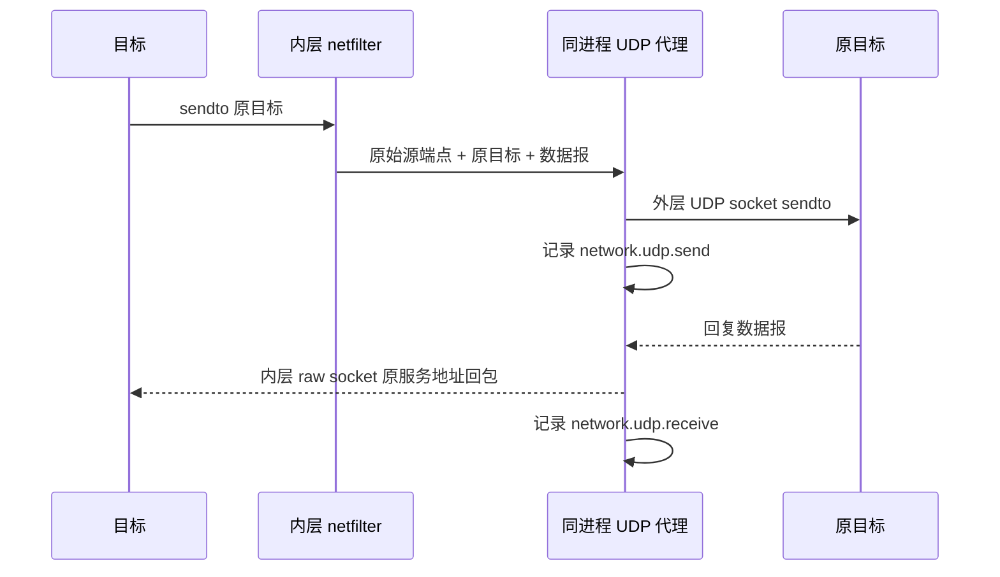

# UDP 客户端采集与转发

UDP 与 TCP 使用同一 namespace/netfilter 初始化，但转发服务、报文处理和统计独立。完整启动流程、权限和五元组关联见[文件与 TCP 采集](file-network-collection.md)。不再修改 connect/sendto/sendmsg 的目的地址，也不修改 recvfrom/recvmsg/getpeername 的结果。

## 数据路径

1. 在目标 user/net namespace 内设置 OUTPUT 标记、策略路由及 PREROUTING TPROXY。IPv4/IPv6 各一个常驻接收 socket 开启透明和原目标地址控制消息。
2. 启动时把接收 FD 和两族 raw 回包 FD 交给外层采集器。接收 socket 仍属于内层，代理本身不切换 namespace。
3. recvmsg 获得真实源端点和原始目的端点，按完整五元组分流；每个活跃流创建一个外层普通 UDP socket，真实出网不经过内层规则。
4. 上游回复使用内层 raw socket 回送，保留真实服务源 IP/端口，并计算 UDP 校验和；回包带 bypass mark，避免再被 TPROXY 捕获。无需每个源端口绑定一个透明回复 socket，不受回复端口与应用监听端口冲突影响。
5. 内层 lo MTU 容纳最大普通 IPv6 报文。保留数据报边界、零字节报文和最大普通 IPv4/IPv6 UDP 负载。

## 归属与记录

ptrace 只采集私有元数据：socket、connect/bind，以及 sendto/sendmsg/sendmmsg/write/writev 的发送者和目的地址。必要时在调用结束查询 getsockname 得到自动源端口。recvfrom/recvmsg/recvmmsg 及 getpeername 不需要停点，真实内核完成短缓冲区、MSG_PEEK/MSG_TRUNC 和接收过滤。

UDP connect 只设置默认目标，不产生出口事件，也不把地址排序探测者当作报文发送者。代理最多等待 250 ms 的元数据屏障，让已进入的发送调用完成，失败调用不成为参与者；超时保留转发，但不猜归属。

发送中的调用按已知源端点和目标端点登记等待范围。完整端点已知时，只等待同一五元组的调用。首次自动分配端口的发送尚无源端点，暂按目标端点保守匹配。目标地址不可读时也保守匹配其未知部分，调用完成或失败后释放等待。共享 socket 的多个发送者继续合并为流参与者。

接收循环只接收、分流和入队，各流 worker 独立等待关联并按 FIFO 转发。一个流等待元数据时，其他流可以继续转发。共享接收循环在连续就绪报文间让出执行预算，供流 worker 消费队列。队列或流容量错误发生在关联前时，事件保留真实端点，并将归属标为 unavailable。

UDP 可以由多个线程/进程共享 FD，甚至多个 socket 共享同一个五元组。记录 `participants`、`socket_ids` 和 `attribution=flow_participants`。参与者按 PID/process_instance_id 去重，同一进程的多个线程算一个参与进程。仅在唯一进程时提供顶层 pid/process_instance_id；多个进程时留空，不能把一个流的全部包归给最近一次调用者。socket_id 也只在唯一 socket 时填写。参与者是该代理流内观察到的发送者集合，不是逐报文的确定因果对应；空闲超时结束后再建立新流。

事件全部来自 `udp_proxy`，`category=network`：

| kind | 含义 |
| --- | --- |
| `network.udp.send` | 代理实际向上游提交一个数据报，含原目标、字节数和 flow ID |
| `network.udp.receive` | 代理已向应用网络发出一个回复，含真实服务 peer 和字节数；不代表应用已调用 recv 消费 |
| `network.udp.transfer` | 流结束时汇总上下行字节数、报文数和结束原因 |
| `network.udp.error` | 发送、回包、容量或队列错误 |

send 成功只证明内核接受该数据报，不证明远端收到。不会再记录 ptrace 的 UDP connect/send/receive/peer 事件，也不会把没有流量的失败 recv 等调用混入出口记录。

## 生命周期与边界

每族最多 1024 个活跃流，每流发送队列 64 个数据报；超出时记录明确丢弃原因。空闲 120 秒回收。根退出后仍服务后代；所有目标退出时排空已接收发送队列，包括零长度数据报，然后汇总，不继续无限等待回复。

流汇总的开始时间在共享接收循环收到首包时采集，覆盖后续排队和元数据等待。检测到同一五元组对应的 socket 代际变化时，先汇总旧流，再创建新的上游 socket 和 flow ID。正常退出等待各流 worker 排空已接收的报文和汇总事件。

覆盖普通 IPv4/IPv6 单播、DNS、connected/unconnected UDP、向量/批量发送、fork/dup/共享 socket，以及接收缓冲区截断。外部服务看到代理的出网地址和源端口；不保证原始 ICMP 错误队列、路由/接口、socket 选项、组播/广播等语义。TLS/QUIC 不解密，未做 QUIC 域名解析。内层 loopback 已有目标 socket 时直接互访，不经过出口代理；外部传入 FD 不在当前保证范围内。
